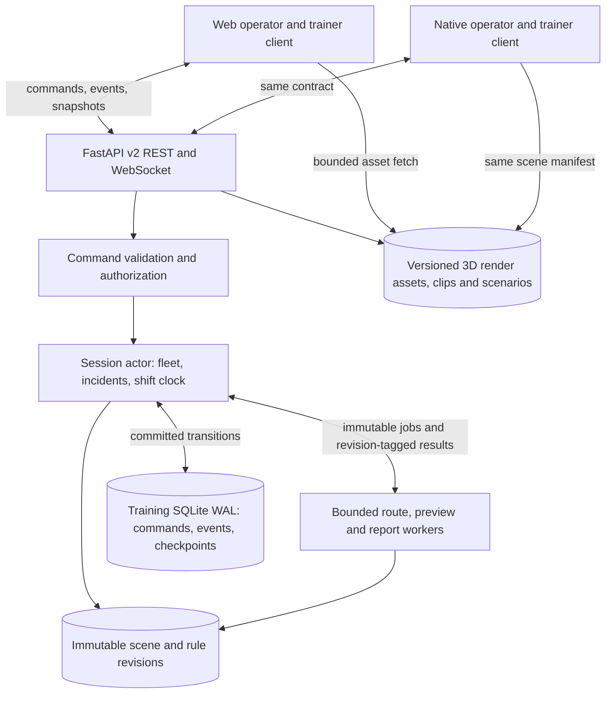

# Formula9 3D Shuttle Fleet Manager Training Simulator

## 1. Status and architectural intent

Architecture revision: **2.1, 27 October 2026**. The 3D-first revision incorporates the user's clarification of 26-27 October. This is the implementation target for M2-M6, not a claim that these capabilities already exist. It supersedes the [earlier decision-policy evaluation plan](archive/architecture-decision.md). M1 remains the reusable data, routing, networking, rendering and audio foundation.

The approved product trains an **AV shuttle fleet manager** to plan a shift around known disruptions, manage unexpected incidents, maintain service while charging vehicles, and review decision outcomes. Trainers author exercises and assess results; route planners consume exported incident patterns. See [requirements and source interpretation](product_direction.md).

Both the React/TypeScript/three.js web application and C++20/Qt/OpenGL native application must complete the same training workflows independently in a mandatory 3D operational world from M2. They may also operate the same backend session. Fleet overview, route editing, incident inspection and vehicle execution use dimensioned 3D geometry and shared spatial state; forms, timelines and minimaps support that world. Neither client becomes a second simulation authority, and a flat map or optional viewer does not satisfy the requirement.

The engineering challenge is coordinated deterministic fleet behaviour with responsive editing, correct concurrent decisions, bounded rendering and recoverable training records. Additional services or algorithms must earn their place through these requirements and measured workloads.

Read with:

- [Integrated milestones and dependency gates](milestones.md)
- [Performance and resilience specification](performance.md)
- [Mandatory 3D scene, spatial and interaction contract](three_d_simulation.md)
- [Backend deliverables](backend/README.md)
- [Web app deliverables](web/README.md)
- [Native deliverables](native/README.md)

## 2. Scope decisions

| Decision | Architecture consequence |
| --- | --- |
| Pre-trip planning is the main task | Route revisions, disruptions, validation, comparison and approval form the first complete workflow |
| Fleet-level training | A session owns many shuttles, service patterns, stops, chargers, incidents and a shared clock |
| Human guidance | Dispatcher commands select constraints/actions; simulated controllers execute them |
| M2 covers network detours | Segment closures and node detours first; local obstacle passing requires the M4 lane-model gate |
| Both clients are required | Shared contracts, fixtures, workflow acceptance and latency budgets apply to both |
| 3D is the core, not an optional viewer | Shared scene package, authoritative poses and spatial constraints; both clients demonstrate navigable 3D from M2 |
| Simplified physics, real spatial semantics | Road-constrained 3D kinematics, support surfaces and swept volumes; tyre/suspension physics and photorealism are not prerequisites |
| Durable output is core | Commands, decisions, results, scoring inputs and reports persist from early milestones |
| Recordings have fixed provenance | Recorded footage is restricted to its captured time/location; generated motion is synthetic |
| Training is the deployment boundary | No real vehicle control, live passenger dispatch or roadworthiness claims |
| Perception is optional from M4 | Recorded-frame inspection cannot block the MVP or silently become world ground truth |
| RL is not required | Interpretable controllers and a constrained planner support the approved product |

Milestone numbers describe delivery gates, not time estimates. The brief's full feature list is distributed across M2-M6; its own recommendation to limit M2 to segment closures and node detours is retained.

The 3D revision adds numbered tasks and exit criteria to every team milestone without removing or renumbering existing work. Earlier optional ECS/detail language now applies only to enhanced inspection; mandatory baseline 3D is delivered in M2. Existing implementation handoffs remain historical evidence for their named tasks, not evidence that the added work has passed.

## 3. Existing foundation and migration

Source inspection on 20 October establishes reuse boundaries. Older test counts are not treated as current results.

| Current implementation | Reuse | New work |
| --- | --- | --- |
| `backend/src/datasets/` | KITTI loading, coordinates, source-frame metadata | Clip manifests, branch provenance and scenario ingestion |
| `services/trajectory_stream.py` | Immutable recorded/route playback | Separate fleet simulator; playback does not become a reactive controller |
| `services/session_manager.py` | Lifecycle and subscribers | Session actor, durable state, commands, fleet clock and recovery |
| `services/route_planner.py` | Preview boundary and bounded cache | Versioned drafts, alternatives, constraints and approval |
| `routing/road_graph.py` | Cached directed OSM graph with direction/access/speed data | Turn relations, ODD/vehicle-fit checks and missing-data states |
| `services/scene_repository.py` | Read-only map and spatial queries | Curated training overlays; separate writable training database |
| `contracts/` | Renderer-independent coordinates and fixtures | Canonical v2 fleet/command/event/report schemas and adapters |
| `frontend/src/app.jsx`, `api/`, `renderer/` | Route interaction, lifecycle, scene/camera | Feature modules, fleet store, bounded worker ingestion and five workflows |
| `Native/App/BackendClient.*`, `GLViewport.*`, `Phase2_3/` | Networking, cancellation, map/3D | Typed fleet state, editor/incident/charging/debrief views and bounded history |
| `Native/Engine/` and FMOD | ECS, GPU assets, cameras and audio | Fleet batching, resource lifecycle and semantic cues |
| `backend/src/perception/` | Optional frame/projection/detection helpers | Separately accepted recorded-data extension only |

Backend paths in this table are relative to `backend/src/` where abbreviated. Current single-trajectory code does not establish fleet simulation, runtime collision checks, charging optimization or decision explanations. Scripted sample reasons remain labelled fixtures until replaced by controller records.

## 4. Runtime topology and ownership

Use a **modular monolith** for beta: one FastAPI authority process per deployment, one sequential actor per active session, one serialized durable writer, and a bounded process pool for expensive pure calculations. One active session is the initial performance scope; additional simultaneous sessions require separate capacity measurements.



| Boundary | Owns | Must not own |
| --- | --- | --- |
| Session actor | Ordering, world state, command application, deterministic controllers, incidents/charging | GPU resources or media decoding |
| Routing/validation | Candidates and named constraints against immutable inputs | Live fleet mutation |
| Storage writer | Transactions, durable commands/events/checkpoints, migrations | Vehicle decisions |
| API | Identity, request bounds, jobs, subscriptions and errors | Independent session logic per request |
| Clients | Draft interaction, presentation, interpolation and inspection | Safety acceptance, scores, charge reservations or authoritative motion |
| Scenario authoring | Versioned definitions, rules, references and rubric | Mutating a published exercise used by an attempt |
| Scene pipeline | Immutable render manifest, support surfaces, operational proxies and semantic bindings | Independent client-specific collision truth or unchecked asset substitution |

FastAPI workers normally have separate memory. Increasing Uvicorn workers would duplicate in-memory session ownership; beta therefore uses one authority worker and bounded calculation processes. Multi-host deployment needs explicit session ownership/routing before replication. [FastAPI deployment concepts](https://fastapi.tiangolo.com/deployment/concepts/)

Local deployment binds to loopback. Classroom LAN deployment adds HTTPS/WSS, server-assigned roles, access tokens, origin checks and authenticated session join. A native launcher may supervise the same backend executable; it cannot embed a competing simulator through nanobind.

## 5. Domain model

Durable records carry stable IDs, schema and source revisions. Units are explicit. Canonical positions remain metres, x=east/y=north/z=up; renderer transforms stay in adapters.

The [3D contract](three_d_simulation.md#4-spatial-wire-contract-and-transforms) defines body origin/axes, unit XYZW orientation, dimensions, support/lane/deck IDs and exact asset/basis transforms. Freeze a compatible spatial-schema extension after auditing current v2 consumers; 3D-required sessions reject missing mandatory pose/scene fields rather than silently flattening them.

| Record | Principal fields and invariants |
| --- | --- |
| ScenarioRevision | Immutable map/recording/rule/vehicle/energy/rubric revisions, seed, fleet, triggers and references |
| TrainingSceneRevision | Shared render-package checksum, operational geometry/proxy revision, origin/axes, asset profile, semantic bindings and supported 3D capabilities |
| SpatialPose / SceneObject | Canonical position/orientation, body dimensions, support surface, collider/asset IDs, scene/object revision and source |
| TrainingSession | Scenario revision, state, tick, epoch, backend authority owner, authorized participant identities, checkpoint cursor |
| FleetVehicle | ID, dimensions, dynamic limits, assignment, progress, state of charge, service state |
| ServicePattern / Stop | Ordered required stops, dwell, departure windows, minimum service, substitution policy |
| RouteDraft / RouteRevision | Base revision, directed edge IDs, waypoints, constraints, stops, time assumptions, validation |
| Disruption | Segment/polygon, active interval, source, reason and revision |
| Incident | Vehicle, trigger, priority, lifecycle, evidence/history, reason, candidates and service impact |
| Candidate | Action/path, trade-offs, required exceptions, dependencies, expiry and validation |
| DispatcherCommand | Idempotency key, authenticated actor, target revisions, reason, payload hash, status, applied tick |
| DecisionRecord | Observation facts, selection/rejections, rule evaluation, actor, provenance and outcome |
| Charger / Reservation | Port, availability, power curve, compatibility and half-open reservation interval |
| ChargePlan / Swap | Travel/charge intervals, reserve forecast, coverage and synchronized handover |
| Event / Checkpoint | Ordered sequence, tick, epoch, state hash, versioned state and RNG state |
| Assessment / Report | Immutable run IDs, rubric revision, component scores, evidence and export checksum |

A vehicle cannot simultaneously be in service and occupying a charger. Charger reservations cannot overlap. Route approvals use revision conflicts. Required stops may only be skipped/substituted through explicit scenario policy and a logged acknowledgement.

## 6. State machines

Session: `DRAFT -> READY -> RUNNING <-> PAUSED -> COMPLETED -> ARCHIVED`.

After restart: `RUNNING/PAUSED -> RECOVERING -> PAUSED`. Incompatible data/version or unrecoverable state enters `FAILED` with a reason. Completed assessments are immutable; retry creates a linked new attempt.

Vehicle service states include `STANDBY`, `IN_SERVICE`, `DWELLING`, `BLOCKED`, `AWAITING_GUIDANCE`, `DETOURING`, `RETURNING_TO_DEPOT`, `QUEUED_FOR_CHARGE`, `CHARGING` and `OUT_OF_SERVICE`. Transitions validate route, energy, reservation and service conditions together.

Incident: `DETECTED -> AWAITING_REVIEW -> OPTIONS_READY -> ACTION_COMMITTED -> EXECUTING -> RESOLVED`.

Alternatives include `WAITING` with a review deadline, `ESCALATED` with a scripted on-site response, and `UNRESOLVED` at shift end. Expired options return to review. An accepted command is not evidence of successful execution.

Hold the affected shuttle at a validated stop if no action is feasible. Other shuttles continue unless globally paused or affected by the same restriction. Closing a UI card cannot resolve domain state.

## 7. Deterministic fleet simulation and clocks

- Fixed timestep **50 ms / 20 Hz**; initial state publication **10 Hz**; rendering is independent.
- One simulation clock governs movement, events, closures, boarding/dwell, charging and service schedules.
- Each tick processes due scenario events, ordered commands/reservations, controller decisions, motion/energy, conflicts, metrics and committed publication in a documented order.
- Stable entity iteration, subsystem RNG seeds, canonical serialization and pinned model/engine revisions support repeatability.
- Bound controller work with local spatial queries. Route/preview/report jobs use immutable inputs and return revision-tagged results through the actor.
- CPU-heavy searches, decoding, export and ML never execute on the API event loop.
- Bound catch-up. If real time cannot be maintained, pause or advertise lag/slow simulation; never silently skip authoritative ticks.

Persist command order, external events, selected worker outputs and their effective ticks. Replay consumes committed worker outputs rather than rerunning asynchronous searches with nondeterministic completion order. Exact state-hash reproducibility is scoped to the pinned runtime/model build; cross-platform comparisons use specified tolerances.

Three clocks have different purposes:

1. Simulation time determines shift and physical outcomes.
2. Monotonic elapsed time measures latency and trainee response.
3. UTC timestamps support audit/export; the shift timezone is scenario metadata.

The 30-second design aspiration is a human decision target, not an HTTP timeout or forced approval. Record incident-raised, alert-rendered, opened, submitted, applied, paused and disconnected times separately. Distinguish server-authoritative operational delay from client-observed presentation delay. Record pauses and assistance so accelerated playback and network faults cannot silently improve scores.

Persist accumulated active assessment durations and interval records at the durable boundaries. Process-local monotonic clock origins cannot be compared across a restart; resume a new interval after recovery, with downtime recorded separately.

### Vehicle/controller model

M2-M3 use a deterministic route-following kinematic model with distance along the approved 3D path, speed, bounded acceleration/deceleration, support-surface height/normal, body orientation from path tangent and surface frame, and stop/dwell states. State updates integrate acceleration over the fixed timestep and preserve nonnegative speed without jumping across a stop or route endpoint. The backend publishes the dimensioned body-centre pose; clients do not infer a separate terrain height or independently drive vehicles.

The controller evaluates speed limits, next service stop, preceding shuttle, active obstruction and incident hold before selecting `PROCEED`, `SLOW`, `STOP`, `WAIT_FOR_GUIDANCE` or `FOLLOW_APPROVED_DETOUR`. Each selection records the actual limiting predicate and observations. A weighted rule/tree implementation can supply this interface, but comparing ML policies is not the training product.

Use vehicle body volumes, route progress and indexed 3D occupancy to enforce separation on the curated scene. A model stopping-distance bound includes reaction allowance, configured braking capability and a margin; test boundary speeds, timestep crossing and emergency holds. Check conservative swept movement between ticks against versioned operational proxies so a fast vehicle cannot tunnel through an obstacle merely because endpoint samples are clear. M2 includes a ramp/support fixture and solid obstruction; M3 adds stacked roads and vertical clearance, avoiding both planar false collisions and missed overhangs. Query limits fail closed with a reason. Queue and junction priority in M2 are explicit scenario rules, not an unimplemented claim of arbitrary traffic intelligence.

Validate energy conservation and dimensional units: travel energy depends on integrated distance, auxiliary energy on elapsed simulation time, and charging adds accepted power times duration and efficiency up to capacity. Version these parameters with each scenario. Tests cover zero distance, prolonged waiting, interrupted charge, empty battery and a detour longer than the nominal loop.

The M4 local-manoeuvre model adds lane-relative lateral motion, swept volume and opposing traffic only within accepted curated micro-scenes. High-frequency physical vehicle dynamics, realistic sensors and city-scale traffic remain outside the core model.

### 3D scene and operational geometry

The [scene pipeline](three_d_simulation.md#3-scene-package-and-content-pipeline) packages a shared constrained GLB render profile, dimensioned semantic entities, support surfaces and simplified collision/visibility proxies. Render meshes and operational geometry share IDs/transforms and validated bounds but may differ in tessellation. LOD and shadows never change collision, visibility or scoring outcomes. Missing mandatory geometry blocks readiness; optional visual detail may use its declared low-detail representation.

The backend stays CPU-only/headless; no GPU renderer or client raycast is required to accept decisions. M4 visibility evidence is computed from authored observation origins and proxy coverage, not the operator's orbit camera. Being visible on screen is not evidence of visibility to a shuttle.

## 8. Recorded data, branch points and replay

Each scenario identifies its source drive, including when adapted for training. Each displayed observation still carries its actual source: dataset-derived does not mean every entity/event was recorded.

| Source mode | Meaning | Permitted behaviour |
| --- | --- | --- |
| `RECORDED_REPLAY` | Original sensor/pose observations at their original geography/time | Inspect, annotate, scrub; immutable trajectory |
| `TRAINING_SIMULATION` | Fleet/events generated from a scenario, possibly inspired by a drive | Route edits, guidance, energy and scoring |
| `RECORDED_SEEDED_TRAINING` | Compatible recorded clip initializes a synthetic world at a declared branch | Original lead-up then synthetic continuation |
| `COUNTERFACTUAL_PREVIEW` | Temporary copy of a current checkpoint | Compare only; no mutation of live fleet/timer/assessment |

Store source mode, recording/sequence/frame IDs where applicable, source timestamps, branch tick, parent snapshot/branch, map/transform revisions and authored-object flags. Provenance belongs to each trajectory/evidence item, not one global flag falsely marking a fleet as recorded.

Branch at the **earliest change to the recorded world**, including a pre-trip detour or inserted obstacle. A subsequent incident uses the last ten seconds of **simulation history**. Never show unrelated KITTI footage as its current camera. A genuine recorded incident can show its synchronized lead-up, followed by a simulated camera or explicit unavailable state.

An authored obstacle over a recorded scene is a labelled training overlay, not something the original camera observed. Missing assets show "Recorded clip unavailable" and manifest identity; no silent substitution.

From M3, a synthetic onboard camera renders the 3D training world and remains persistently labelled `SIMULATED VIEW`. History and preview cameras bind the correct immutable scene revision, poses and branch; they do not manufacture recorded sensor frames or calibrated perception evidence.

KITTI was captured around Karlsruhe. A one-north-style exercise may use a synthetic map and separately identified reference clip; relabelling coordinates does not turn KITTI footage into Singapore footage. [Official KITTI description](https://www.cvlibs.net/datasets/kitti/)

Seeking history in a client is local inspection, not global rewind. A trainer explicitly restarts an attempt or creates a sandbox branch. Counterfactual previews copy all interacting fleet, event, energy and reservation state from the same checkpoint and have independent cancellation/resource budgets.

## 9. Route authoring, validation and approval

### Draft to committed route

1. Select service/vehicles and load route, map and constraint revisions.
2. Draft segment closures and ordered waypoints; M3 adds time windows and avoid polygons.
3. Request validation and bounded alternatives against the same immutable revisions.
4. Show failures at their map feature; compare distance, travel/dwell time, stops, energy and rule implications.
5. Submit approval with reason, targets, candidate/draft ID and dependencies.
6. Recheck freshness/current feasibility; commit route revision and assignments together.
7. Apply pre-trip immediately or in-trip at a declared safe splice point; publish and record outcome.

Preview has no side effects. Undo/redo changes local drafts. Initial approval is all-or-nothing for the requested vehicle set, with per-vehicle rejection reasons.

Both clients pick/edit stable features on the 3D road surface with an explicit deck/surface identity and keyboard/list equivalents. Inverse-transform hit points into canonical coordinates; the backend validates placement, dimensions and geometry revisions. Overlapping XY surfaces are not interchangeable. M3 trainer obstacle placement creates a validated scenario draft or audited intervention, never an authoritative mutation by moving a client mesh.

| Check | Evidence | Failure behaviour |
| --- | --- | --- |
| Connectivity/direction | Directed edges continuous through ordered waypoints | Reject disconnected/wrong-way route |
| Turns/access | Restriction relations or curated overlay; vehicle permissions | Reject forbidden access; missing critical rules are `UNKNOWN` |
| Time window | Edge traversal interval including dwell and closure interval | Reject overlap; recheck changed assumptions |
| Vehicle fit | Width/height, turning envelope and required clearance | Reject insufficient fit; unknown cannot pass |
| Stops | Required order and permitted substitutes/skips | Reject loss or request explicit allowed substitution |
| Operational design domain (ODD) | Approved area, road classes and scenario conditions | Reject out-of-domain route |
| Energy/service | Route plus depot energy, reserve and coverage forecasts | Explain affected vehicle and interval |
| Dynamic execution | Occupancy, conflicts and incident constraints | Stop/replan when the route becomes infeasible |

Map centrelines cannot establish lane width, passing clearance or allowed marking crossings. Curate/version the bounded training network where metadata is missing. Return `PASS/WARN/FAIL/UNKNOWN`; approve only if mandatory checks are known and satisfied.

Use edge-based search to enforce turn restrictions, bounded diverse alternatives and versioned cost functions for time/distance/service/energy. Do not claim global optimality for a bounded heuristic. Cache keys include map, rule, disruption, vehicle, departure-time and service constraints.

### Exceptions and local manoeuvres

The mockup's double-line option is a training concept. M2 offers wait, escalation and network detours. M4 may enable local passing only after curated lane geometry, vehicle swept volume, visibility and oncoming-conflict acceptance tests.

An exercise-authorized exception records rule ID, road extent, vehicle, expiry, approver and reason. It can relax only that named training rule. It cannot bypass collision, unknown clearance, occlusion or physical-fit checks. Insufficient visibility makes the option unavailable with an explanation. Exercise policy is not real-world legal authorization.

## 10. Incidents and guidance

Incident definitions contain cause, affected road/vehicle, priority, facts available to the trainee, expected guidance trigger, difficulty and permitted actions. The controller requests guidance when allowed actions are exhausted, scenario approval is needed or evidence is insufficient.

Explanations derive from evaluated predicates and constraints. "Low confidence" is a traceable qualitative availability/ambiguity state unless a probability model is separately validated.

Actions include a validated suggested detour, manual draft through the same validator, wait until review, simulated on-site escalation, and a named permitted exception after its capability gate.

Candidates carry map/rule/route/world dependencies, expiry, assumptions, estimated trade-offs and visibility limits. Recheck at commit and during execution. A moved obstacle, changed occupancy or resolution by another operator invalidates stale options.

Prioritize concurrent incidents by urgency, service impact and age, not popup order. Deduplicate alerts by durable event ID. Escalation stays inside the training scenario.

## 11. Battery, charging and service continuity

Version the energy model: capacity in kWh, distance and idle/accessory consumption, optional acceleration/load terms, charging efficiency, acceptance power and taper. Start with an explicit simple model. Mockup values such as 15% reserve or 40 minutes to charge are configurable fixtures.

Forecast remaining loop, detour, wait and depot energy. Show uncertain inputs/estimates; present reserve margin, not just current percentage. Charging plans jointly check:

- Vehicle/port compatibility and maintenance windows.
- Non-overlapping reservations, travel/arrival and charge duration.
- Reserve through the timeline and reachability of the next charge.
- Minimum in-service fleet, stop coverage and scenario headway targets.
- Swap location, transfer/dwell, replacement readiness and assignment revision.

Reserve resources and assignments atomically. Reforecast after disruption, missed arrival, outage or rejected swap. Start with deterministic greedy scheduling and bounded repair; extensions retain the common validator and explain their trade-offs.

Exercises may allow poor choices that cause service gaps or reserve breaches and score the consequences. Label them as noncompliant outcomes. Do not hide a breach by clamping the display to reserve; physical state of charge is bounded by 0-100%, not the training reserve.

## 12. Trainer workflow, assessment and reports

Author drafts from recording manifests, map/rule overlays, fleet/chargers, disruptions, difficulty, triggers, acceptable outcomes and rubric. Validate references, geometry, reachability, feasibility, event order and reference solutions before publishing an immutable revision.

M2 ships one authored fixture and deterministic debrief. M3 adds minimal in-app author/publish. M4 adds advanced composition and shift variation. Both clients use the same revision; trainee endpoints withhold reference answers until debrief.

Record distinct rubric components: safety/compliance, correct-decision time, attempts, detour efficiency, service coverage and energy management. The 0-100 composite is proposed, configurable and versioned. A critical unsafe outcome fails the attempt regardless of speed. Accept multiple feasible solutions and compare references under identical conditions.

Preserve raw timing, denied attempts, exceptions, missed stops, time/distance delta, minimum separation, reserve breaches, charger conflicts, coverage and unresolved incidents. Absence of detected collisions in a simplified model is not a real-world safety guarantee.

M3 exports:

- JSON: scenario/run/version manifest, decisions, outcomes and provenance for replay/analysis.
- CSV: structured incidents/decisions, stable IDs, units and formula-safe text.
- HTML report: score components, incident reasons, route changes, energy/service effects and reference explanation.

PDF rendering is an optional adapter, not required for export. Reports read immutable committed records and apply access/redaction rules. M4 aggregates by road/category/scenario revision, labelling small samples as training exercises rather than operational statistics or AV training datasets.

## 13. Contract v2 and transport

Create `contracts/v2/` schemas, units, positive/negative fixtures and compatibility policy at M2. These proposed endpoints are not implemented by this documentation change; freeze exact routes at the contract gate.

| Proposed API | Purpose |
| --- | --- |
| `GET /api/v2/capabilities` | Schema/features/modes, resource limits and builds |
| `GET /api/v2/scenes/{id}/revisions/{revision}/manifest` | Versioned spatial/render profile, content hashes, geometry bindings and readiness requirements |
| `GET /api/v2/assets/{content_hash}` | Authorised immutable bounded asset download; geometry/media never rides in tick snapshots |
| `GET/POST /api/v2/scenarios` | Catalogue/authorized draft creation |
| `POST /api/v2/scenarios/{id}/publish` | Validate and publish immutable revision |
| `POST /api/v2/sessions` | Create attempt from scenario revision/seed |
| `GET /api/v2/sessions/{id}/snapshot` | Consistent fleet/incident/service baseline |
| `POST /api/v2/sessions/{id}/route-previews` | Draft validation/candidate job |
| `POST /api/v2/sessions/{id}/charge-previews` | Charge/swap validation |
| `POST /api/v2/sessions/{id}/commands` | All mutating lifecycle/route/incident/charge actions |
| `GET /api/v2/sessions/{id}/commands/{key}` | Reconcile ambiguous outcome |
| `GET /api/v2/sessions/{id}/events?after=...` | Paginated durable replay |
| `GET /api/v2/sessions/{id}/history?from_tick=...` | Bounded history with provenance |
| `GET /api/v2/sessions/{id}/assessment` | Role/phase-appropriate assessment |
| `POST /api/v2/sessions/{id}/exports` | Immutable export job |
| `GET /api/v2/jobs/{id}` | Progress/failure/artifact reference |
| `WS /ws/v2/sessions/{id}` | Events, snapshots, cursors and health |

Illustrative command; identity comes from authentication, not this body:

```json
{
  "contract_version": "2.0",
  "command_id": "cmd-003-0142",
  "command_type": "APPROVE_INCIDENT_OPTION",
  "expected_epoch": 3,
  "expected_revision": 12,
  "target": {"incident_id": "inc-0142"},
  "payload": {"candidate_id": "option-B-r4"},
  "reason": "Use the validated side-road detour and approved temporary stop."
}
```

Use target aggregate revisions; do not require equality with a constantly advancing global tick for every click. Revalidate relevant candidate/world dependencies at application.

### Durable commands

1. Authenticate/authorize; bound input and validate target/dependencies.
2. Serialize a transaction persisting the actor/session-scoped idempotency key, payload hash and `QUEUED` command. Identical retries return the prior result; different payload/same key conflicts.
3. Return durable acceptance, not application success.
4. Actor orders queued commands at a tick boundary, rechecks state and constructs next state.
5. Atomically commit result, domain changes, event sequence and recovery information before publishing `APPLIED`/`REJECTED`.
6. On timeout/reconnect, clients query the same command ID; never invent a new command or show approval from `QUEUED`.

After recovery, applied commands remain applied once at the domain level. Old queued commands become `NEEDS_RECONFIRMATION`/expired unless explicitly safe and revalidated. A reconnect cannot cause surprise delayed approvals. Network delivery itself may duplicate.

Errors include `STALE_REVISION`, `OPTION_EXPIRED`, `UNKNOWN_CONSTRAINT`, `NO_FEASIBLE_ROUTE`, `CHARGER_CONFLICT`, `ROLE_DENIED`, `QUEUE_FULL` and `SESSION_RECOVERING`, with retryability and usable current revisions.

### Snapshots and events

Every envelope carries session, epoch, schema and revision. Snapshots add snapshot ID, tick, simulated time and included event cursor; events add monotonic event sequence and entity revision.

- Durable incident/command/score events are ordered, cursor-acknowledged, deduplicated and replayable; never evict them as vehicle telemetry.
- Fleet snapshots may coalesce to the newest complete state. Start full; deltas require baseline IDs and gap/resync tests.
- Join/reconnect obtains a consistent snapshot at cursor N then events after N, without a gap between read and subscription.
- Disconnect a subscriber that cannot drain reliable events with a resumable cursor; database history supplies catch-up.
- New epochs reset interpolation/transient work. Already consumed event IDs prevent historical audio replay.
- Scene/video/point-cloud assets use bounded HTTP paths/caches, not tick payloads.

Browser WebSocket does not provide automatic receive backpressure, so bounded decode, coalescing and producer rate control are application responsibilities. [MDN WebSocket](https://developer.mozilla.org/en-US/docs/Web/API/WebSocket)

## 14. Persistence, audit and recovery

Keep immutable scene SQLite separate. Add local `training.sqlite` with migrations, foreign keys, unique command/event keys and explicit transactions. Use WAL, one serialized writer, and FULL synchronization for acknowledged durable decisions; measure its cost.

SQLite WAL permits concurrent readers and one writer and requires same-host storage. Avoid network shares. Reports use short reads or immutable exports so they do not indefinitely stall checkpoints. [SQLite WAL](https://www.sqlite.org/wal.html)

Schema groups: scenario revisions/assets; sessions/attempts; route/constraint revisions; commands/results; events; checkpoints; incidents/decisions; charge reservations; assessment components; export manifests.

Persist recovery information through the last published tick: deterministic inputs, external-result effective ticks, RNG/checkpoint references and state hashes. Commit batches at publication boundaries and flush a command's effective transition before its applied event. Stage next state while writing; failure pauses at the last committed state.

After crash: obtain exclusive authority ownership, validate schema/assets, restore checkpoint, replay journal to last committed tick, verify hash, increment epoch, reconcile commands and expose `PAUSED`. Resume is explicit; downtime does not run assessment timers. Uncommitted progress is not claimed as recovered.

Use periodic checkpoints, bounded in-memory history and indexed pagination. Set retention quotas before classroom use. Expired previews/caches may be cleaned automatically; completed attempts/reports follow explicit retention policy. Backup/restore includes the database and referenced immutable assets. Copying only a live SQLite main file is not a supported backup.

## 15. Web architecture

Split `app.jsx` into fleet/routes/incidents/energy/trainer/debrief features with a shared connection shell.

A mandatory three.js 3D workspace loads the shared scene profile from M2, with overview/orbit/follow/incident cameras, raycast selection and explicit editing modes. M3 adds surface-aware trainer placement, synthetic onboard view and isolated 3D history/preview. The same entity store drives 3D geometry, 2D panels and minimap; React UI status never competes with mesh state.

Pipeline: transport worker -> schema validation -> immutable normalized entity store -> UI selectors and bounded renderer adapter. Small selectors update affected UI; three.js updates stable meshes without rerendering the React tree every tick.

Draft previews use debounce, cancellation and latest-request generations. Durable commands survive navigation through reconciliation. Cache scene chunks by revision, assets by source ID and history by session/epoch/tick with byte limits.

Instance/batch geometry, cull/LOD, cap pixel ratio and dispose GPU assets on scene changes. Under load, prioritize operator controls, incidents and validation over decorative detail.

Preserve road-constrained pose interpolation and depth-aware routes/selection; do not interpolate through corners, obstacles or discontinuities. Asset decode/upload jobs are bounded and revision-cancelled. Context loss retains command reconciliation and a labelled accessible fallback; it does not count as passing normal 3D operation. [3D interaction and recovery rules](three_d_simulation.md#6-client-interaction-replay-and-rendering)

UI states distinguish loading, validation pending, command pending/applied/rejected, stale, reconnecting and unsupported. Reconnect never submits a draft. Historical inspection retains live alerts and "Return to live".

Light/dark themes, >=14 CSS-pixel body text, keyboard operation, non-colour labels, scalable layouts and reduced motion are baseline. Audio uses meaningful event IDs, mute/volume and user-gesture handling; no alerts repeated from historical playback.

## 16. Native architecture

Separate network/contracts, immutable store, Qt view models, command coordinator, history/assets and renderer adapters. Replace raw `QJsonObject` propagation with typed values validated at ingress.

The OpenGL/ECS operational viewport is mandatory from M2 and integrates with the Qt fleet/editor/incident panels. Add the shared render-profile importer, tested canonical-to-render/asset transforms, stable semantic picking and camera modes; the existing map widget is a supporting view, not the only complete training path. M4 improves environment/inspection depth rather than introducing 3D for the first time.

Workers publish bounded immutable data. Qt models mutate on their UI owner; GL upload/draw/destruction require the current owner context. Extend existing `QPointer` and generation checks across callbacks and context recreation. [Qt context/thread and cleanup requirements](https://doc.qt.io/qt-6/qopenglwidget.html)

Stable backend entity IDs drive ECS, reserved buffers, batching and LOD. Bound asset upload work per frame. Primary 3D, supporting map and text views use the same snapshot. Replace indefinitely growing trajectory maps with display windows plus backend history. Test semantic/spatial parity with web; lighting need not be pixel-identical. Graphics-loss fallback is visibly degraded and must restore the pinned scene before spatial actions needing that evidence re-enable.

Qt exposes fleet, editor/validation, incidents, charging, trainer and debrief workflows. Desktop layout can differ, but capabilities/outcomes match web. FMOD has event deduplication and explicit teardown. Missing optional audio/high-detail assets cannot block operation.

Separate native release targets from Python/nanobind when those dependencies only serve offline dataset tools. The packaged client connects to the API; installing an ML runtime is not a native prerequisite.

## 17. Reliability and observability

[performance.md](performance.md) owns all numerical budgets and workload definitions. Instrument command receive/queue/commit/apply/render, workers, tick compute/lag, database write/checkpoint, state age, reconnect and asset load.

Trace by session/command/job/event ID while keeping metric labels bounded. Observe queue count/bytes, superseded snapshots, replay gaps, worker timeouts, stale results, history bytes, memory/VRAM and frame times. Health distinguishes liveness/readiness/session lag.

Bound clients, commands, previews, assets, exports and sessions. Prioritize committed events over speculative previews. Reject overload explicitly. Slow subscribers and reports cannot block other clients or mutate simulation.

M5 injects restart, disk failure, timeout, congestion, malformed messages, role violations, duplicates, stale approvals, clock changes, GPU context loss and long-session churn. M6 repeats acceptance on frozen packages and measured hardware.

## 18. Migration and module layout

1. M2 freezes v2 fixtures and identity, keeping legacy replay isolated.
2. Add fleet/session/storage behind existing scene/routing adapters; one scenario proves the five main screens.
   Add the shared 3D scene/spatial extension, authoritative surface-following poses and mandatory operational 3D in both clients during this M2 slice.
3. Move both clients to v2 training; retain labelled v1 replay until v2 replay parity.
4. M3 completes editor/charging/trainer, durable reports and concurrent-client tests.
5. M4 deepens training and gated local manoeuvres; optional perception stays independent.
6. M5 finishes parity and removes unsupported debug/legacy paths from release.
7. M6 freezes schema/assets/models/packages and publishes acceptance/recovery evidence.

Each run has one implementation/schema authority; no indefinite dual writes. Old replay adapters cannot manufacture fleet/incident semantics.

```text
backend/src/
  training/       # fleet, sessions, clocks, scenarios
  dispatch/       # incidents, commands, guidance
  planning/       # drafts, constraints, candidates, revisions
  energy/         # charging, swaps, coverage
  assessment/     # rubric, reports, patterns
  persistence/    # repositories, migrations, journal/checkpoints
  transport/      # v2 events, snapshots, cursors
contracts/v2/     # schemas and positive/negative fixtures
frontend/src/features/
  fleet/ routes/ incidents/ energy/ trainer/ debrief/
Native/App/
  Contracts/ State/ Commands/ ViewModels/ Features/
```

These are proposed boundaries, not instructions to move useful files without a functional reason.

## 19. Open validation items

| Item | Working decision | Evidence / owner |
| --- | --- | --- |
| M2 local passing | Network detours now; local manoeuvre gate M4 | Geometry/conflict fixtures / backend + native |
| Two clients | Full parity; web default classroom entry, native equivalent desktop | Same task scripts / UX + clients |
| Source city | Preserve KITTI; label adapted maps synthetic | Manifest review / data owner |
| Live disruption feed | Manual versioned fixtures | Terms, quality and access / product + backend |
| Legal approval claims | Exercise policy only | Authoritative research / product |
| Confidence/occlusion | Traceable qualitative states | Validation before probabilities / backend |
| Energy/rubric realism | Configurable training assumptions | Instructor/domain review / product + backend |
| Hardware budgets | Proposed targets; lock profile M2 | CPU/GPU/RAM/driver/browser measurements / integration |
| 3D content and importer profile | Shared versioned low-poly GLB package plus operational proxies; full 3D required, photorealism optional | Content inventory, transform/fit fixtures and 3D P1 / backend + both clients |

Pending research and mockup numbers do not become established facts through inclusion in the technical plan.
