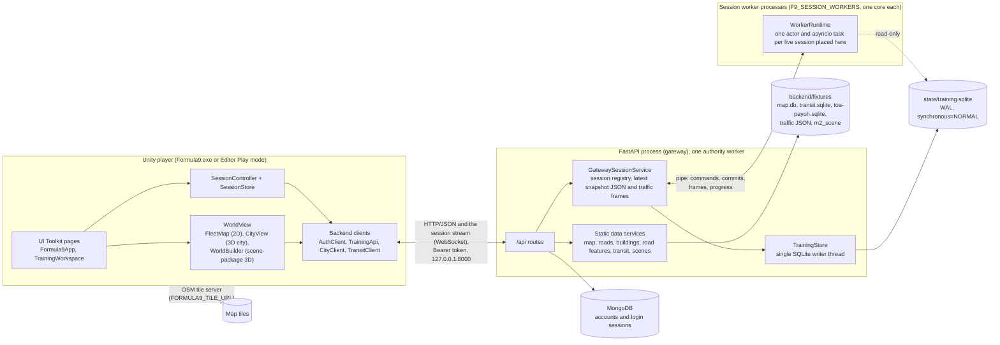

# Formula9 technical architecture

Revision **3.1, 13 November 2026**. This revision describes the system as it is built today: one
Unity client and the Python/FastAPI backend that was migrated into this repository. Revision 3.1
describes incidents as world events that the background traffic plays out, decided for per exposed
shuttle. Revision 3.0 (12 November 2026) replaced revision 2.1 (27 October 2026), which planned two
separate clients, a React/three.js web app and a C++/Qt/OpenGL desktop app. Neither client exists in
this repository any more. The Unity client took over their training workflows.

Formula9 trains an **AV shuttle fleet manager**. The trainee plans a detour around a closed road,
handles incidents as they come up, keeps shuttles in service while they charge, and reviews what
happened afterwards. The exercise runs on real Toa Payoh (Singapore) streets, with a sample of
background traffic and simulated traffic lights. See [product direction](product_direction.md) for
the requirements this comes from.

Read with:

- [Repository README](../README.md): setup, running, building, data refresh and testing
- [Session creation and recovery](session_creation.md): session lifecycle, HTTP contract, crash recovery
- [Training contract v2](../contracts/v2/README.md): wire rules, entities and transition tables
- [Backend migration record](backend-migration.md): what was moved from `Formula_9`, and how
- [Third-party vehicle assets](third_party_assets.md): imported model packs and their licence status

## 1. Principles

| Principle | What it means in the code |
| --- | --- |
| The backend is the only simulation authority | Shuttle motion, energy, incidents, charging, route checks and scores are computed in Python. Unity displays them and sends commands. It never moves a shuttle along its route, recalculates energy or approves a route itself. |
| Durable before visible | A command result, event or snapshot is published only after its SQLite transaction has committed. |
| One contract, validated on both sides | `contracts/v2` defines the wire format. Python validates it with pydantic. Unity validates incoming JSON against the same schemas, which are generated into C#. |
| Deterministic, recoverable sessions | One actor per session advances in fixed 50 ms steps from a seeded RNG. Its private state is checkpointed with each publication, so a restarted backend resumes the same attempt. |
| Presentation is separate from authority | Traffic-light colours, building textures and camera views are presentation. They never decide whether a shuttle reached a stop or a decision was correct. |
| Incidents are simulated, not scripted | This replaces "traffic is presentation" for incidents. An incident is a world event that the background traffic plays out: a breakdown pins a vehicle in its lane, a collision two, a signal fault sticks a junction on red. The queue, and so a shuttle's delay, comes from the traffic, which is therefore deterministic and checkpointed with the session. Sessions without traffic fall back to a speed factor on the event's roads. |
| Honest data provenance | Real data (OSM roads, LTA bus stops and road features, the vehicle population) is labelled separately from simulated data (light timings, incidents, energy model). |

## 2. Repository layout

| Path | Contents |
| --- | --- |
| `Assets/Formula9/Runtime` | Unity client code, the `Formula9.Runtime` assembly (references glTFast and Newtonsoft.Json) |
| `Assets/Formula9/UI` | UI Toolkit pages (`Pages/*.uxml`), styles (`Formula9App.uss`), theme and panel settings |
| `Assets/Formula9/Resources/Formula9` | Audio clips, building textures, shaders/materials and the traffic vehicle catalogue |
| `Assets/Formula9/Editor` | Scene builder, Pages window and batch player build |
| `Assets/Formula9/Tests/EditMode` | EditMode, live-backend and end-to-end tests, plus copies of the shared contract fixtures |
| `Assets/Scenes/Formula9.unity` | The only scene; rebuilt by **Formula 9 → Rebuild client scene** |
| `Assets/<vendor packs>` | Imported vehicle and traffic-light packs (see [third-party assets](third_party_assets.md)) |
| `backend/src` | FastAPI application and simulation services (section 4) |
| `backend/fixtures` | Static map, Toa Payoh scenario, traffic, transit, buildings, incident catalogue and the M2 scene package |
| `backend/tests` | pytest suite |
| `contracts` | v2 pydantic models, generated JSON Schemas, fixtures and alert cues; the legacy v1 REST/WebSocket contracts |
| `Tools` | Backend launcher, contract generator, isolated test backend, executable builder, bundled-backend supervisor |
| `scripts` | Scene-package builder and optional KITTI/ML utilities |
| `state` | Default location of the live session database (`training.sqlite`, ignored by Git) |
| `run.bat`, `build.bat` | Windows entry points for setting up and running, and for building the bundled executable |

## 3. Runtime topology

- The client keeps one WebSocket open to the joined session (`WS /api/v2/sessions/{id}/stream`,
  section 4.7.1): the backend pushes its newer snapshots and its traffic frames as they are made.
  Everything else is plain HTTP, and while the stream is down the client polls snapshots once a
  second and long-polls traffic frames, as before (sections 6.4 and 6.6).
- The backend binds to loopback by default. `FORMULA9_BACKEND_URL` points the client somewhere else.
- **Development:** `run.bat` (or `python Tools/run_backend.py`) runs the backend from `backend/.venv`,
  and the Unity Editor connects to it.
- **Bundled build:** `build.bat` builds the Windows player and places a portable Python with the
  backend, fixtures and contracts in `Builds/Formula9/Backend`. Each `Formula9.exe` starts
  `Backend/serve.py` hidden (`BundledBackend.cs`). All open players share one backend process, which
  shuts down cleanly once the last player has closed (`Tools/bundled_backend.py`). If a backend is
  already listening on the port, the player uses it instead.

Only one FastAPI worker may run against a database. Live sessions are held by that process (and the
session worker processes it starts), so more Uvicorn workers would each claim the same sessions. The
session workers are not Uvicorn workers: they serve no HTTP and never write to the database
(section 4.3.1).

## 4. Backend

### 4.1 Module map

| Package under `backend/src` | Responsibility |
| --- | --- |
| `app.py`, `api/router.py`, `api/routes/` | Application assembly, middleware (auth, tracing, CORS), error handlers and route modules |
| `auth/` | Sign-up, log-in and log-out. PBKDF2-SHA256 password hashes. Opaque bearer tokens valid for 12 hours, stored only as hashes. `MongoAccountStore` holds the data. |
| `core/` | Settings (`config.py`, read from `backend/.env`), error envelope, per-request training trace telemetry |
| `services/training_sessions.py` | `TrainingSessionService`: admission, lifecycle, ticking, commands, traffic frames, recovery, all in one process |
| `services/session_gateway.py`, `session_worker.py`, `session_ipc.py` | The gateway that runs sessions in worker processes: placement, admission by load, forwarding, worker supervision and recovery; the worker's entry point; the pipe between them |
| `services/session_stream.py`, `api/routes/training_stream.py` | The session stream: snapshots and traffic frames pushed to a client over a WebSocket as they are committed and made |
| `services/session_actor.py` | Base planar fleet actor: five shuttles on loops, separation and motion |
| `services/integrated_actor.py` | `IntegratedSessionActor`: the Toa Payoh exercise (route detour, incidents, depots, charging, traffic, signals) |
| `services/spatial_session_actor.py`, `spatial_motion.py`, `training_scene.py` | Road-constrained 3D actor bound to the hash-pinned M2 scene package |
| `services/route_edit.py`, `route_outcome.py` | Route editor context, draft previews, mandatory checks, approval and post-run outcome |
| `services/incidents.py`, `incident_scenarios/` | Incident lifecycle, candidates, history/debrief and the seeded random incident catalogue |
| `services/battery_decision.py`, `charge_booking.py`, `energy/` | Energy model, forecasts, charge options, charger bookings and battery assessment |
| `services/crash_recovery.py` | Process-crash recovery checks used by the session service |
| `traffic/` | Road network, background traffic (`city_traffic.py`), its native engine and the choice of engine (`native_traffic.py`), signal cycle, incident hazards and the import scripts |
| `routing/` | OSM road graph, operating network, map matcher, Singapore fixture and building importers |
| `transit/` | LTA bus stop and service store, plus its OSM and DataMall importers |
| `persistence/` | `TrainingStore` and its SQL migrations `0001`–`0005`; `StoreClient`, the store as a session worker sees it |
| `datasets/`, `perception/`, `services/trajectory_stream.py`, `session_manager.py` | Legacy KITTI trajectory playback and optional perception helpers (v1 API) |

### 4.2 Scenarios

A session is created from a scenario revision. The Unity client offers only the first scenario in the
table. The backend still runs the other two, and the client can join existing sessions of those kinds.

| Selector | Actor | World | Status |
| --- | --- | --- | --- |
| `scenario-m2-integrated-r1` | `IntegratedSessionActor` | Planar contract on real Toa Payoh roads. Shown as a 2D map and a 3D city. | **Default.** Unity labels it "Singapore, real streets (2D)". |
| `scenario-m2-road-3d-r1` | `SpatialSessionActor` | Synthetic local frame from the hash-pinned GLB scene package | Supported. Not offered for creation. |
| `scenario-m2-r1` | `SessionActor` | Planar five-shuttle loop | Legacy fixture. |

The integrated fixture (`backend/fixtures/m2_integrated.json`) is built by
`python -m src.routing.build_singapore_fleet_fixture` from the committed OSM extract. It has:

- five shuttles, each on its own route with LTA bus stops: `route-peer-a` (shuttle-01) and four peer
  routes on two peer loops, two shuttles a loop. Every route is a list of operating-network roads with
  its own route editor data (`route_edit` and `route_edit.peer_routes`), so any of them can be edited
  and taken round an incident
- two depots: Toa Payoh Interchange and Saint Michael's Bus Terminal
- incidents from `fixtures/incidents/predefined_scenarios.json`: a `timeline` of scheduled world events
  (`BREAKDOWN`, `COLLISION`, `ROAD_CLOSURE` on an edge, `SIGNAL_FAULT` at a signalled junction) beside the
  random generator. A random event is placed for an in-service shuttle chosen with the session RNG, about
  `warning_s` at cruising speed ahead of it, so it is detected 60–120 s before that shuttle gets there.
  Each template's `warning_s`, `detection_delay_s`, `duration_s` and `recovery_s` are used. The scripted
  road block on shuttle-01's next road 10–11 s in is the optional `tutorial_opening` setting, off by default
- the incident rules in `fixtures/m2_incident.json`: the options offered (`reference_acceptable_actions`:
  `KEEP_ROUTE`, `ROAD_DETOUR`, `ESCALATE`, `HOLD_AT_STOP`), option lifetimes, how far assistance shortens
  an event (`escalation_after_ticks`) and the provisional rubric (`m2-incident-provisional-r2`)
- shuttle-05 starting near its energy reserve, so it gets a charging decision early

### 4.3 Session service and ticking

`TrainingSessionService` owns every live attempt when sessions run in the backend's own process
(`F9_SESSION_WORKERS=0`); otherwise each session worker runs one for the sessions placed on it
(section 4.3.1):

- **Admission:** up to 16 live sessions. In one process, up to 6 of them can run background traffic;
  with session workers, each worker's measured load decides instead. Past that, the service answers
  `QUEUE_FULL`. `POST /api/v2/sessions` needs an `Idempotency-Key`, so a retried
  create returns the same attempt. Session IDs are readable, for example `toa-payoh-007-10nov-1340`.
- **Clock:** a running actor advances in fixed **50 ms ticks (20 Hz)**. Ticks are scheduled against
  high-resolution deadlines. A late tick does not delay the ones after it, and a backlog of up to
  0.25 s is caught up. READY and PAUSED sessions do not advance.
- **Publication:** each tick is staged on a copy of the actor in a worker thread. A presentation
  snapshot is committed every two ticks (10 Hz). The staged actor is installed only after its
  transaction commits.
- **Ordering:** one lock per session orders ticks, lifecycle commands and decisions. All route,
  incident and battery decisions take that lock.
- **Traffic frames:** the integrated actor steps its background traffic every two ticks. The service
  keeps the latest 30 frames in memory, and `GET …/traffic` returns up to one second of them
  (section 6.6).
- **Lifecycle:** the commands are `START`, `PAUSE`, `RESUME` and `ARCHIVE`. `ARCHIVE` ends an attempt,
  frees its slot and keeps its final snapshot, events and command receipts. `DELETE`, `purge` and
  `compact` remove old attempts and reclaim disk space (see
  [session creation](session_creation.md#permanent-deletion-and-disk-cleanup)).

### 4.3.1 Session worker processes

Under CPython's global interpreter lock, every session that ticks in one process shares one core. The
backend therefore runs live sessions in **session worker processes** (`F9_SESSION_WORKERS`: `auto` by
default, the physical cores less two within 1–8; `0` runs them all in the backend's process). The
FastAPI process becomes the **gateway** (`GatewaySessionService`), with the same routes and replies:

- **Gateway:** the session registry (session to worker), the only SQLite writer, each live session's
  latest committed snapshot JSON, and each one's latest traffic frames with the long-poll waiters.
  Commands, route approvals and the signal state are forwarded to the owning worker.
- **Worker:** loads the scenario and road network once, freezes them out of full garbage collections,
  and ticks its sessions exactly as `TrainingSessionService` does. Its store is a `StoreClient`: reads
  use its own read-only SQLite connections, and writes are calls to the gateway's writer. A
  publication is encoded in the worker (`TrainingStore.encode_commit`) and only written by the gateway
  (`submit_commit`), so the gateway does no Pydantic work for it. The worker installs a staged actor and
  pushes its traffic frame only after the gateway answers that the commit is durable.
- **Placement and admission:** each worker reports each session's tick and mean cost per tick four
  times a second. A new session goes to the least-loaded worker while that worker's load plus the new
  session's estimate stays within 60% of a tick (30 ms); an empty worker takes any one session.
  Estimates are the median measured cost of running sessions of the same kind, or 15 ms with traffic
  and 5.4 ms without before any are measured.
- **Failure:** a worker that exits, closes its pipe or stops reporting for 3 s is ended. Its sessions
  answer `SESSION_RECOVERING` and are recovered from their last committed checkpoint onto the workers
  still running (or its replacement), as at a backend restart: a new epoch, paused, queued commands
  marked for reconfirmation. A replacement worker starts in the background. Workers watch the gateway's
  process and exit when it is gone, so a killed backend leaves none behind.
- **Ordering and determinism:** a session's ticks still run in order on one actor in one process, so
  the number of workers changes no committed state (`test_session_workers.py` compares every committed
  checkpoint with the in-process runtime's).
- **Route previews** are kept by the process that made them, the gateway; a forwarded approval carries
  the preview it approves.
- **Logs:** workers log to the gateway's console. When the gateway writes to a file (the bundled
  backend's log), each worker writes beside it, to `<log>.worker-N`.

`Tools/run_backend.py --reload` sets `F9_SESSION_WORKERS=0` unless it is set, so reloading does not
restart the workers each time. Tests run in one process too (`backend/tests/conftest.py`), except
`test_session_workers.py`.

### 4.4 Integrated actor

Each tick, `IntegratedSessionActor` does the following:

- **Shuttle motion:** moves shuttles along their admitted route geometry at the scenario speed. It
  includes stop dwell, held stops, incident holds and the depot trips: drive to the bay, charge, then
  park in a standby space.
- **Signals:** stops shuttles at red lights. Each junction runs the same simulated 70 s two-phase cycle
  (`traffic/signal_cycle.py`). Stop lines come from the LTA road-feature fixtures.
- **Traffic:** drives the background traffic sample through `CityTraffic`, using the Krauss
  car-following model. Shuttles share the kerb lane with that traffic. `plan_shuttle` limits a
  shuttle's speed for the vehicles ahead of it, and `place_shuttle` records where its body went. Live
  world events are played out in it (`_apply_events`): `pin_vehicle` stops a breakdown's vehicle (a
  collision's two) in its lane, a collision's or a closure's scene is kept clear both ways
  (`traffic/incident_hazards.py`), and a signal fault overrides its junction to stuck red, which the
  shuttles, the traffic and `…/signals/state` all obey. The queue behind forms of its own accord; nothing
  is drawn or scripted. It is deterministic and checkpointed (about once a second; the traffic state is
  65–100 KB), and a recovered session drives it on from its checkpoint to the session tick, replaying the
  same events.
- **Traffic engine:** the traffic is about four fifths of a tick's work in Python, so sessions normally
  drive it natively: `backend/native/traffic/traffic_core.cpp`, a nanobind module that
  `Tools/build_native.py` builds into `traffic/_traffic_native`. It is `city_traffic.py` step for step,
  with CPython's own rounding (its `math.hypot`, float `%`, `** 2` and `sum`), so both engines give
  bit-identical state and continue each other's checkpoints; `city_traffic.py` stays the reference and
  the fallback. `native_traffic.engine()` picks the engine: native when the module is built from the
  current source, else Python (`F9_NATIVE_TRAFFIC`: `0` Python, `1` native or fail). The native engine
  lets go of the GIL while it steps the traffic and plans, places and checks the shuttles, so the
  sessions of one process (or one session worker) tick on several cores at once. A staged copy shares
  the vehicles until one side steps, as the Python engine's does. Both engines walk the pedestrians of
  the area's walkways file in the same step (`walk_network.py`; off with `F9_PEDESTRIANS=0`), so
  vehicles and shuttles give way to them at crossings and a shuttle held for them says so in the traffic
  frame (`held_by: "pedestrians"`). Change the driving and the walking in both;
  `test_native_traffic.py` holds them to each other, and the traffic tests run on both engines.
- **Energy:** charges travel and auxiliary energy with energy model `ENERGY_R1`. It also issues
  `CONTINUE` and `CHARGE_NOW` offers, runs scheduled charger bookings, and sends a shuttle back to a
  depot when its reserve requires it.
- **Incidents:** places the timeline's world events when they are due, and random ones for any
  shuttle on its route (and the tutorial opener when a scenario turns it on). Each event is a
  checkpointed record; the incident's config is the scenario's shared rules plus that record. On
  detection, and every 10 ticks after, it works out the event's **exposure**: every shuttle whose
  remaining route crosses the footprint (the scene and the queue feeding it) before it clears, with its
  distance and ETA, about how long keeping its route would hold it up (the footprint it still has to
  creep through at the speed in the queue, or the wait for a closure or a stuck light to clear) and the
  stop it could hold at short of the footprint.
- **Decisions per exposed shuttle:** `IncidentService` offers each exposed shuttle its own options:
  `KEEP_ROUTE` (drive on and absorb the delay), `ROAD_DETOUR` (when its route is one the route editor can
  take round the event: any shuttle's route or a detour from it; not for signal faults), `ESCALATE`
  (request assistance, once per event, which brings `Incident.clears_at_tick` forward) and `HOLD_AT_STOP`
  (when it has a stop before the footprint). A decision is recorded as that shuttle's
  `Incident.responses` entry; the others' options are then reissued. The actor carries each one out: a
  detour is the shuttle's own route (`{incident}-detour-{shuttle}`), and a hold keeps it dwelling at its
  stop until the event clears. Nobody is frozen in traffic sessions: a shuttle meets the queue as any
  vehicle does, and only a road closure is a `Disruption` (which route validation sees). Without
  traffic, a road block on a shuttle's route still holds that shuttle where it was detected until it
  is decided for and the road reopens.
- **No decision is still a decision:** an exposed shuttle that was offered options and drives into the
  footprint undecided gets a `NO_DECISION` response, scored zero; it can still be decided for, late. The
  incident's state sums up its shuttles: `OPTIONS_READY` while one is to be decided for, then `EXECUTING`
  (a detour being driven), `ESCALATED` or `WAITING`. When the event clears it settles as `UNRESOLVED` if
  a `NO_DECISION` remains, else `RESOLVED`.

Domain consequences go through the existing services (`RouteEditService`, `IncidentService`, the
energy package). The actor adds its private execution state to the same commit.

### 4.5 Commands and decisions

| Action | Endpoint | Notes |
| --- | --- | --- |
| Lifecycle, incident option, charger reservation, continue service, schedule or cancel charge | `POST /api/v2/sessions/{id}/commands` | Returns `202` with a `CommandStatus`: `QUEUED`, then `APPLIED` or `REJECTED`. Each command has an idempotency key per actor and session. Decision commands need a reason. |
| Check a route draft | `POST …/route-previews` | No side effects. Returns the directed path, the polyline, the mandatory checks (`PASS/WARN/FAIL/UNKNOWN`) and original against edited metrics. |
| Approve a route | `POST …/route-approvals` | Checks the draft again, then commits the route revision for the named shuttles. |
| Preview an incident option | `POST …/incident-previews` | Reads a committed branch without advancing live time. |
| Preview a charge booking | `POST …/charge-schedule-previews` | Reserves nothing. The commit runs the same check. |
| Confirm an unclear outcome | `GET …/commands/{key}` | Used after a lost reply or a recovery. |

An incident option is for one shuttle (`Candidate.vehicle_id`), and each shuttle is decided for once.
Its assessment (`INCIDENT_DECISION_RECORDED`) is per shuttle: safety, response time from detection
(full credit also needs the decision before the shuttle reaches the incident; a late one earns half),
attempts at that shuttle's options, stops still served, and **delay avoided**: the chosen option's
estimated delay against keeping the route, scaled to the best option on offer. The estimate comes from
the queue's length and the speed in it, not from a simulated branch, so every score is provisional.
`GET …/incidents/{id}/debrief` returns each shuttle's latest assessment (`assessments`) and its
`responses`.

The shared validator in `contracts/v2/models.py` rejects stale revisions, expired or withdrawn offers,
and transitions not allowed by the state tables. Error codes include `STALE_REVISION`,
`OPTION_EXPIRED`, `CHARGER_CONFLICT`, `INVALID_TRANSITION`, `QUEUE_FULL` and `SESSION_RECOVERING`.

### 4.6 Persistence and recovery

`TrainingStore` is a single SQLite database with one writer thread. It runs with WAL,
`synchronous=NORMAL` and foreign keys on. In WAL mode NORMAL keeps every commit through a crash of
the backend process and keeps the database consistent through anything; only a power loss or OS
crash can roll back the last few commits, which recovery treats like progress not yet committed.
`FULL` cost one fsync per publication (ten a second per running session) on the one writer thread.

A publication (`commit_snapshot`) is serialised once, on the calling thread (in a session worker,
on the worker's side), with Pydantic's own encoder. The writer checks it against the session's stored boundary (`boundary_json`: snapshot ID,
epoch, event sequence, tick, scene, transform and scenario revisions) instead of parsing the stored
snapshot. The store keeps the latest committed snapshot JSON of every session not yet ended in
memory, set once each commit is durable, and `GET …/snapshot` returns those bytes as they are, with
no database read and no parsing. Tests set `F9_VALIDATE_PUBLICATIONS=1` (in `backend/tests/conftest.py`)
so every publication is still checked against the contract there.

| Migration | Tables |
| --- | --- |
| `0001_training.sql` | `sessions`, `commands`, `events`, `checkpoints` |
| `0002_live_sessions.sql` | `session_runtimes` (private actor checkpoints), `session_creations` (idempotent creation keys) |
| `0003_session_numbers.sql` | `session_numbers` (the running number in readable IDs) |
| `0004_session_traffic.sql` | `session_traffic` (traffic checkpoints, kept apart from the per-publication checkpoint) |
| `0005_snapshot_boundary.sql` | `sessions.boundary_json` (what the next publication must follow) |

Public snapshots, events, command outcomes and private actor state commit in one transaction. Private
checkpoints are versioned: v1 planar, v2 spatial, v3 integrated. They hold shuttle progress, dwell,
battery, the RNG, holds, charge timers, depot journeys and traffic. They never appear in HTTP replies.

On startup the service does the following:

- restores every live attempt and increments its epoch
- marks queued decisions `NEEDS_RECONFIRMATION`
- returns unstarted attempts to READY and started ones to PAUSED, so Resume is always explicit
- marks only the affected attempt `FAILED` (`CORRUPT_CHECKPOINT`) when its checkpoint is corrupt or
  incompatible

Downtime does not advance simulation time. See
[session creation](session_creation.md#runtime-and-recovery) for the full rules.

### 4.7 HTTP API

All routes are under `/api`. `/api/v2/sessions/*` requires a bearer token.

| Group | Routes |
| --- | --- |
| Accounts | `POST /auth/signup`, `POST /auth/login`, `POST /auth/logout`, `GET /auth/me` |
| Health | `GET /health` |
| Training sessions | `GET/POST /v2/sessions`, `POST /v2/sessions/purge`, `POST /v2/sessions/compact`, `DELETE /v2/sessions/{id}` |
| Session state | `GET …/{id}/snapshot`, `GET …/{id}/events?after=`, `GET …/{id}/traffic?after_tick=&wait_ms=`, `WS …/{id}/stream` |
| Routes | `GET …/{id}/routes/{route}/editor`, `GET …/{id}/routes/{route}/outcome`, `POST …/{id}/route-previews`, `POST …/{id}/route-approvals` |
| Decisions | `POST …/{id}/commands`, `GET …/{id}/commands/{key}`, `POST …/{id}/incident-previews`, `POST …/{id}/charge-schedule-previews` |
| Incident review | `GET …/{id}/incidents/{incident}/history`, `GET …/{id}/incidents/{incident}/debrief` |
| 3D scene package | `GET /v2/scenes/capabilities`, `GET /v2/scenes/{rev}/manifest`, `GET /v2/scenes/{rev}/assets/{asset}`, `POST /v2/scenes/{rev}/readiness` |
| City data | `GET /buildings/{area}`, `GET /roads/{area}`, `GET /traffic/{area}`, `GET /road-features/{area}/signals`, `…/signals/state`, `…/crossings`, `…/markings` |
| Transit | `GET /transit/bus-stops`, `GET /transit/bus-services`, `GET /transit/bus-services/{no}/stops` |
| Legacy v1 | `POST /routes`, `GET /scenes/{id}`, `GET /scenes/{id}/chunks`, `/simulations`, `WS /ws/simulations/{id}` |

The legacy v1 trajectory playback API is kept and tested, but the Unity client does not use it.

### 4.7.1 Session stream

`WS /api/v2/sessions/{id}/stream?traffic=&after_tick=&snapshot_interval_ms=`
(`api/routes/training_stream.py`, `services/session_stream.py`; messages in
`contracts/v2/stream.py`) pushes what a client used to poll for, from what the gateway already holds:

- **Snapshots:** the first message is the session's committed snapshot, exactly as `GET /snapshot`
  sends it. The store's writer tells a `SnapshotFeed` after each commit, which wakes that session's
  streams on the event loop; each stream then sends the newest snapshot, at most one per
  `snapshot_interval_ms` (100–5000, default 250; the Unity client asks for 250). Snapshots coalesce:
  a stream skips them, never sends an older one after a newer, and never sends events. A client reads
  events from `GET /events` when a snapshot's `event_sequence` is past its cursor.
- **Traffic:** with `traffic=true`, every traffic frame after `after_tick` as it is made, in the
  `/traffic` reply's shape. The client turns it on and off with `{"type": "traffic", "enabled": …,
  "after_tick": …}` as the 3D city is shown or hidden.
- **Heartbeat** after 5 s with nothing else, so a paused session is not a lost connection.
- **Errors end the stream:** the session deleted or unknown (`INVALID_REFERENCE`, close 4404), no
  login (`ROLE_DENIED`, 4403), the session recovering (`SESSION_RECOVERING`, 1013), the backend
  stopping (1001). The client then polls over HTTP, which reports the state as before, and opens a new
  stream later.

The login is the bearer token on the upgrade request. Commands, route approvals and previews stay on
HTTP. Streams work the same with and without session workers, since commits land in the gateway's
writer and the workers push their frames there.

## 5. Shared contracts

- `contracts/v2/models.py` (with `sessions.py`, `route_edit.py` and `spatial.py`) is the source of
  truth. `python -m contracts.v2.generate_fixtures` writes the JSON Schemas and fixtures.
  `scripts/build_m2_scene.py` writes the spatial schemas and the scene package.
- `python Tools/generate_contracts.py` generates the Unity side. It writes
  `Runtime/Contracts/Generated/ContractModels.g.cs` (C# classes),
  `ContractSchemas.g.cs` (the schemas, embedded) and `AlertCues.g.cs`, and copies the shared fixtures
  into `Tests/EditMode/Fixtures`. Do not edit the generated files by hand.
- `ContractParser` parses every incoming message, and `SchemaValidator` checks it against the embedded
  schema. `ContractRules` repeats the cross-field checks of the pydantic validators (references,
  cursors, revisions). A message that fails is refused; the client does not try to repair it.
- Version rules: `contract_version` is `2.x`. Unknown fields are accepted. Unknown enum values, other
  major versions and invalid references are rejected. Battery, booking and spatial fields are optional
  2.x additions.

### Units and coordinates

| Quantity | Convention |
| --- | --- |
| Position | Local metres, x east, y north, z up, from the scenario's geographic origin |
| Heading | Degrees anticlockwise from east (+x) |
| Speed, energy, power, time | m/s, kWh, kW, seconds; one logical tick is 50 ms |
| Unity mapping (`WorldMath`) | Contract (x, y, z) becomes Unity (x, z, y), from right-handed Z-up to left-handed Y-up. GLB assets are taken into the body frame by `asset_to_body` after undoing glTFast's X flip. |
| Traffic frame vehicles | 14 bytes each in base64: index, x cm, y cm, heading in 0.1°, speed cm/s |

## 6. Unity client

Unity **6000.1.12f1**, built-in render pipeline, Linear colour space, UI Toolkit. Packages used:
glTFast, Newtonsoft.Json and the Test Framework.

### 6.1 Layers

| Folder (`Runtime/`) | Main types | Responsibility |
| --- | --- | --- |
| `Backend` | `HttpTransport`, `BackendClientBase`, `AuthClient`, `AuthSession`, `TrainingApi` (with `WorkflowApi` and `TrafficApi`), `CityClient`, `TransitClient`, `BackendEndpoint`, `BundledBackend` | HTTP access. Each failure is one of three exceptions: `BackendErrorException` (a full error reply), `NoReplyException` (the outcome is unknown, so the command must be confirmed, never re-created) or `NotLoggedInException`. The token is kept in memory only. |
| `Contracts` | Generated models, `ContractParser`, `SchemaValidator`, `ContractRules` | Typed, validated contract objects |
| `Session` | `SessionController`, `SessionStore`, `DecisionRules` | Creating, joining and polling a session; event replay; the command lifecycle; read-side checks on offers |
| `UI` | `Formula9App`, `TrainingWorkspace`, `ChargingPage`, `ReportsPage`, `IncidentReportsTab`, `NotificationQueue` and `NotificationStack`, presenters, `ReportFilter`, `LoginBackdrop` | Pages and their bindings. Presenters are plain static classes so they can be tested without a scene. |
| `World` | `WorldView`, `FleetMap`, `CityView`, `WorldBuilder`, `SceneLoader`, `CityTrafficRenderer`, `CityIncidents`, `ShuttleMotion`, `ShuttleCameraRig`, `TrafficPlaybackClock`, `RoadMesh`, `CityMesh`, `LtaMappedRoadPaint`, `BusStopShelterFactory`, `Traffic/` | The 2D map, the 3D city, the scene-package world, interaction and cameras |
| `Audio` | `AlertGate`, `TrainingAlerts`, `AlertPlayer`, `BatteryWatch`, `UiSounds`, `Preferences` | Training alerts, deduplicated by event ID; interface sounds; the Mute alerts preference |
| `Editor/` | `SceneBuilder`, `PagesWindow`, `PlayerBuild` | Rebuilding the scene and panel settings, previewing and editing pages, batch player builds |

### 6.2 Application flow and pages

`Formula9App` is the scene's `MonoBehaviour`. It holds a `UIDocument` and switches between the pages
in `Assets/Formula9/UI/Pages`:

1. **Login** (`LoginPage.uxml`): log in or create an account.
2. **Main shell** (`MainShell.uxml`): the session list and the training workspace. From the session
   list you can create, join or archive a session. Admin actions archive every live session, delete
   a finished one, delete all but the 20 newest finished ones, and reclaim disk space. `TrainingWorkspace` binds the workspace pages by control `name`:
   - **Fleet Overview:** fleet cards, the map or 3D view, follow and overview cameras.
   - **Route Planning:** one shuttle at a time. Before the start, the detour exercise in five steps:
     Problem, Detour, Check, Approve, Outcome. While running, the shuttle's incident decisions (see
     6.3).
   - **Charging:** battery forecasts, charger occupancy, offers, bookings and the reserve-or-continue
     decision.
   - **Reports:** the latest 1,000 events and 200 commands this client has seen, with search and
     filters, and an **Incidents** tab listing the session's incidents with each one's history
     (replayed on a map, a sample at a time) and debrief.
   - **Scenarios:** a placeholder. A scenario is chosen when a session is created, and configuring
     scenarios is not built yet.

Fleet Overview and Route Planning show the world view beside them. The other pages take the full
width. Controls are found by `name`, so a page's layout can change in UI Builder without changing code,
and pages are looked up by name, so one left out of the layout moves no other.

### 6.3 Incident decisions

There is no Incident Monitor page any more: incidents are decided where the shuttle is planned
([plan: issue 80](https://github.com/axewhy-xy/Formula9/issues/80)).

- **Notifications:** `NotificationQueue` opens one notification per shuttle and incident when an
  incident alert arrives (detected, another shuttle will reach it, options ready), and closes it
  when that shuttle is decided for, its options are withdrawn or the incident ends. `NotificationStack`
  shows the soonest three over the map's top-right corner, each with **Decide** and ×. Incident
  alerts pass the same gate as their sounds, so muting and replays behave alike.
- **Route Planning:** **Decide** opens it on that shuttle and frames the incident; it never changes
  the page, the view or the cameras by itself. A **Needs a decision** strip lists every waiting
  shuttle, soonest first, and the nav item shows how many. The Problem card says what the incident
  is, where, when the shuttle reaches it and what keeping its route costs, with a countdown to the
  options' expiry. `DecisionRules.PendingDecisions` works these out per shuttle from the snapshot.
- **Options:** Keep route, Hold at a stop, Request assistance and Re-route on the map. One the
  backend doesn't offer is greyed out with the reason (a signal fault can't be routed round). Each
  opens a confirm row with a reason; Confirm looks the option's ID up again, so a reissued option
  asks the operator to choose again instead of sending a stale one. Re-route opens the route editor
  for that shuttle; approving its route sends the decision. Pausing or losing the connection
  disables them, with a hint saying why.
- **Review:** Reports → Incidents (`IncidentReportsTab`) describes each incident and what was
  decided, without asking anything, and loads its History and Debrief.

### 6.4 Session controller and store

`SessionController` keeps one joined session in step with the backend:

- **Create:** keeps the creation key and its owner until the attempt is confirmed, so a lost reply
  never creates a second session.
- **Stream:** keeps a session stream open to the joined session (section 4.7.1), read and parsed off
  the main thread (`Backend/SessionStream.cs`). Its snapshots go through the same checks as polled
  ones; one no newer than the snapshot held is passed over. A stream that ends, or is silent for 15 s,
  hands back to the poll at once, and the next is tried 2 s later, doubling up to 60 s while none
  delivers.
- **Poll:** asks for the snapshot every **1 s** while no stream delivers, and replays events from the
  last committed cursor. While one delivers, the poll only confirms creations and commands and
  catches up events a streamed snapshot announced.
- **Epoch change:** fetches the events a recovery appended. If an event batch has a gap, it takes a
  fresh snapshot instead.
- **Commands:** keeps at most one command open. A lost reply is confirmed by resending the same
  command, or by asking for its status after a recovery, backing off up to 5 s. A command stays with
  the account that sent it, across logins. Outcomes the backend can no longer confirm become
  `NEEDS_RECONFIRMATION`.

`SessionStore` accepts only valid updates. It refuses older epochs, stale or reused snapshots and
event gaps, and keeps the latest 1,000 events. The UI reads only from the store's accepted state.

### 6.5 World views

`WorldView` owns the world panel and picks what it shows from the snapshot:

| View | When | What it draws |
| --- | --- | --- |
| `FleetMap` (2D) | Every planar session, and the fallback whenever 3D is unavailable | Routes, closures, shuttles, depots, chargers, incident markers. OSM tiles (`MapTiles`) and LTA bus stops on the real-streets scenario. Route editing (`FleetMap.RouteEditing`): click roads to build the draft. |
| `CityView` (3D city) | Planar sessions on real streets, when the user switches to 3D | Extruded OSM buildings with textured walls (`CityMesh`, `CityBuilding.shader`), asphalt roads and kerbs (`RoadMesh`), LTA road paint, bus shelters, traffic lights, depots, routes, shuttles (Kozak bus model), background traffic and incident scenes |
| `WorldBuilder` (scene package) | Spatial sessions (`FULL_SNAPSHOT.spatial` present) | GLB entities from the hash-pinned M2 package |

For scene-package sessions, `SceneLoader` downloads the manifest and checks it against the snapshot's
pinned hash. It checks each mandatory GLB's size and SHA-256 before decoding. `WorldBuilder` places
each entity and checks its drawn size against the declared `dimensions_m`. The client then posts
`/readiness`, and Start stays disabled until that succeeds.

Other parts of the world view:

- **Shuttle motion:** `ShuttleMotion` glides each shuttle along its road between the 1 Hz snapshots,
  instead of letting it jump. In the 3D city, while traffic frames are arriving, a shuttle's body is
  drawn from those frames instead.
- **Shuttle cameras:** `ShuttleCameraRig` mounts four 90° cameras (front, rear, left, right) on the
  selected shuttle, about 2 m above the road. They can take the place of the 3D view: one large, the
  rest as thumbnails (click one to enlarge it). They leave out the planning overlay layer, and their render textures exist only while
  the cameras are on.
- **Incidents:** `CityIncidents` builds each live incident's scene: barriers or a wreck and a response
  van, a beacon, and the queue backing up. `IncidentSimulation` decides what goes where, from the
  incident's first events. The backend's `incident_hazards.py` uses the same rules, so the traffic it
  drives stops behind the queue the client draws.
- **Culling:** traffic is culled against every active camera, so the shuttle cameras and the main view
  each draw only what they can see.

### 6.6 Background traffic

The backend drives the traffic (section 4.4). The client only draws it:

1. `CityClient` loads `/api/traffic/{area}` once: the vehicle sample, models, sizes and road network.
2. While the city is shown, the session stream sends each frame as it is made (section 4.7.1);
   without a stream, `SessionController` long-polls
   `GET /api/v2/sessions/{id}/traffic?after_tick=…&wait_ms=1000`. Either way about ten frames arrive
   per simulated second.
3. `TrafficPlaybackClock` keeps the drawn time a little behind the newest frame and adapts to how
   quickly frames really arrive, so uneven delivery does not stutter.
4. `CityTrafficFollow` interpolates vehicles and shuttle bodies between frames.
   `CityTrafficRenderer` draws them with GPU instancing.

`CityTrafficDriving` and `CityTrafficShuttles` are a client-side fallback for a backend that sends no
frames. Any change to how traffic drives is made in `backend/src/traffic/city_traffic.py` first. The
snapshot, not the traffic frame, stays the authority on where a shuttle is along its route.

### 6.7 Alerts and sounds

`AlertGate` plays a sound only for the event keys listed in `contracts/v2/alert_cues.json`. Each event
ID plays at most once, history never plays, and muting still marks events as seen. **Mute alerts** is
saved in `PlayerPrefs`. `UiSounds` adds hover, start, map-point and dropdown sounds. These are separate
from training alerts and are not affected by Mute alerts.

## 7. Update cadences

| Data | Producer → consumer | Rate |
| --- | --- | --- |
| Simulation tick | Actor | 20 Hz (50 ms) |
| Committed presentation snapshot | Actor → `TrainingStore` | 10 Hz (every 2 ticks) |
| Snapshot push | `TrainingStore` → session stream → `SessionController` | Each commit, at most 4 Hz (250 ms) |
| Snapshot and event poll | `SessionController` → `/snapshot`, `/events` | 1 Hz while no stream delivers; events when a snapshot has new ones |
| Traffic frame | Actor → memory ring of 30 frames → session stream (or long-poll) | 10 Hz, each as it is made |
| Traffic checkpoint | Actor → `session_traffic` | About 1 Hz |
| Rendering | Unity | Every frame; motion interpolated |
| Map tiles, buildings, roads, bus stops | Static services and tile server → client caches | On demand, cached in memory and on disk (tiles) |

## 8. Data sources and provenance

| Data | Source | Real or simulated |
| --- | --- | --- |
| Roads and operating network | OpenStreetMap extract (`fixtures/osm`, `fixtures/map`) | Real geometry, simplified to ≤64 waypoints per loop |
| Buildings | OSM, in `fixtures/buildings/toa-payoh.sqlite` | Real footprints and heights; textures are illustrative (CC0) |
| Bus stops and services | OSM with LTA stop codes; optional LTA DataMall import | Real |
| Signal heads, crossings, markings | LTA DataMall road-feature files | Positions are real. Colours and timings are **simulated** (70 s, two phases). Junction grouping and approaches are worked out locally. |
| Background traffic | LTA annual vehicle population, sampled by percentage | Counts are real. Placement, sizes, colours and behaviour are illustrative. |
| Shuttles, energy, incidents, charging | Scenario fixture, `ENERGY_R1`, incident catalogue | Simulated training data |
| KITTI trajectories | Optional download (`scripts/download_kitti.py`) | Recorded; used only by the legacy v1 playback |

Screens that show LTA or OSM data must credit them. `FleetMap` draws these credits.

## 9. Testing

| Suite | Command | Covers |
| --- | --- | --- |
| Backend | `run.bat --test` (temporary storage, MongoDB off) | Contracts, actors, traffic, signals, energy, incidents, route editing, persistence, real process crash and recovery, API |
| Unity EditMode | Test Runner, or `Unity.exe -batchmode -runTests -testPlatform EditMode` | Contract parsing and fixtures, presenters, session controller and store rules, world maths, traffic playback, camera rig, alerts |
| Live backend | `LiveBackend` category; skipped without a backend | The client against a running server |
| End to end | `EndToEnd` category with `FORMULA9_E2E_BACKEND_URL` set to `Tools/isolated_backend.py --seed-incidents` | Sign up, create, start, approve detour, reserve charger, incident preview and approve, history and debrief, 3D load. `RouteWalkthrough` plays the route exercise through the real UI. |

The end-to-end tests sign up throwaway users. Never point them at the shared team backend.

`--seed-incidents` schedules known incidents in every session (a collision on a road two shuttles
drive, and a signal fault), beside the random ones. The incident end-to-end test and
`RouteWalkthrough` decide these, so without the flag they fail after waiting for them (60 seconds
for the end-to-end test).

## 10. Known limitations

- **Single authority process.** Live sessions are in memory, so the backend runs one worker on one
  host. Scaling out would need session ownership and routing first.
- **Snapshot deltas.** The session stream sends whole snapshots (about 30 KB for the integrated
  exercise) up to four times a second. Delta encoding would cut that further, but has not been needed on loopback. The old v1
  WebSocket is not used.
- **Local deployment only.** No TLS. Roles are not enforced beyond being logged in. CORS defaults to
  a development origin. Classroom LAN use would need HTTPS, roles and origin checks.
- **Simulated signals and incidents.** Light timings, turning phases and incident behaviour are made
  up, and must be shown as simulation.
- **No turn restrictions.** The map data has none, so the route checks refuse only U-turns. Width and
  headroom are checked only where the curated overlay records them, and unknown values block approval.
- **Assessment is provisional.** Debrief rubric scores are uncalibrated. An incident's delay avoided
  is estimated from the queue length and the speed in it, and ETAs leave out traffic lights; branching
  the traffic to simulate each option ahead is not implemented. Scenario completion, trainer authoring
  and exports (JSON, CSV, HTML) are not implemented.
- **Asset licences.** Several imported vehicle packs have no recorded licence (see
  [third-party assets](third_party_assets.md)).
- **Spatial scenario.** The scene-package 3D scenario still works but is no longer offered for
  creation. The real-streets city is the main 3D experience.
