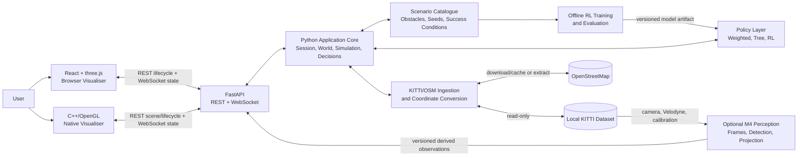
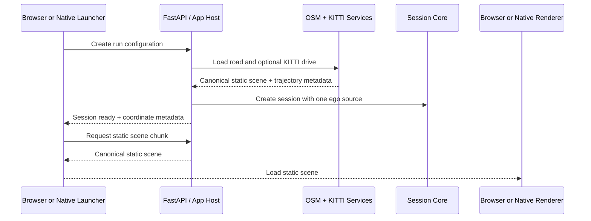

# Formula9 Autonomous Vehicle Decision and Simulation Platform

> Historical plan, superseded on 20 October 2026 by [the fleet training architecture](../architecture.md). Tasks, priorities and links below describe the earlier direction and are not current commitments.

## Technical Architecture

**Project:** Formula9

**Status:** Proposed decision-agent extension following completion of the M1 foundation

**Primary change:** Pivot the product emphasis from trajectory visualisation to developing, testing, comparing, and explaining the algorithm behind a simulated autonomous vehicle. The existing web and native visualisers remain presentation and evaluation clients for the same backend-owned agent.

## 1. Purpose

Formula9 is an explainable autonomous-vehicle decision and simulation platform. Its core product is a backend-owned agent that observes a deterministic simulated world, evaluates safe actions, advances the vehicle, and records why each action was selected. The visualisers make that process visible and allow the same scenario to be replayed or compared across decision methods.

The system now has two presentation targets:

1. A web frontend using React and three.js, connected to the backend through REST and WebSocket.
2. A local native frontend implemented in C++ and OpenGL, connected to the backend through the same REST and WebSocket boundary.

Both frontends consume the same canonical scene, scenario, decision, and simulation data. Neither frontend owns vehicle decisions, safety filtering, state transitions, routing authority, or coordinate conversion. The Python backend remains the authoritative source of state.

The M1 KITTI replay, OpenStreetMap (OSM) road network, REST/WebSocket boundary, shared contracts, and both visualisers remain useful foundations. KITTI is retained for recorded replay, initial conditions, and validation against real telemetry; it is not treated as an interactive environment and cannot be changed retroactively by an agent.

## 2. Scope

### 2.1 Must Have

- Load a bounded OSM drivable road network and convert it into routing and renderable road data.
- Download an approved KITTI raw drive without committing the dataset to the normal Git repository.
- Extract timestamped KITTI OXTS values needed for the ego vehicle, including latitude, longitude, altitude, roll, pitch, yaw, and useful velocity fields.
- Convert OSM and KITTI geographic data into one documented local metric coordinate system.
- Preserve M1 KITTI trajectory replay as a distinct `OBSERVE_ONLY` run mode.
- Support a deterministic, seeded, fixed-tick simulation whose state changes in response to agent actions.
- Keep one authoritative ego-state source for each run.
- Support repeatable scenarios containing pedestrians, blocking vehicles, blocked lanes, road closures, and multiple simultaneous obstacles.
- Implement a deterministic safety filter that cannot be bypassed by a weighted, decision-tree, or reinforcement-learning policy.
- Implement an interpretable weighted-decision baseline and a decision-tree policy behind one policy interface.
- Train and evaluate a reinforcement-learning policy through the same observation/action interface, with the deterministic policy retained as the release fallback.
- Produce structured, inspectable decision records containing the selected action, inputs, safety constraints, scores, tree path where applicable, rejected actions, and policy revision.
- Stream state from FastAPI to the browser visualiser over WebSocket.
- Render the same canonical state locally through a C++/Qt/OpenGL client.
- Keep bounded immutable snapshots for pause, inspection, deterministic replay, and policy comparison.

### 2.2 Should Have

- Start, pause, resume, reset, playback-speed, and timeline controls.
- Scenario creation controls and versioned, repeatable regression fixtures.
- Run the same scenario seed against two policies and compare actions, safety interventions, and outcomes.
- Replan a global route when a simulated road closure invalidates the current route.
- Chunked/batched road geometry and camera-dependent culling in both renderers.
- Export normalised KITTI poses and completed simulation runs as JSON or a compact binary format.
- A headless backend mode that does not require a GPU, display, or native executable.
- Lane-change actions only after the scene model exposes lane identity, adjacency, width, and occupancy; until then the supported driving actions are longitudinal.

### 2.3 Could Have

- LiDAR point-cloud rendering in the native renderer after the decision MVP is stable.
- An M4 perception proof of concept that trains or fine-tunes a detector, or deploys a versioned pretrained detector, against KITTI camera frames; associates detections with projected LiDAR depth; and emits provenance-rich perception observations for offline or `OBSERVE_ONLY` evaluation.
- Durable saved scenarios and historical runs.
- Live OSM updates and, only after the M4 perception acceptance gate passes, optional perception-derived policy inputs.
- More detailed vehicle dynamics after the kinematic baseline has been validated.

### 2.4 Out of Scope

- Production autonomous-driving control or roadworthiness claims.
- Production-grade perception, end-to-end sensor-driven vehicle control, or treating unvalidated perception output as simulation ground truth.
- Streaming camera images or full point clouds in every WebSocket tick for the baseline.
- City-scale traffic simulation.
- Treating a recorded KITTI trajectory as though it were geographically captured on a Singapore road.
- Requiring the native renderer on a remotely deployed or headless API server.
- Allowing an RL policy to bypass deterministic safety constraints or directly control a real vehicle.

## 3. System Context



The diagram represents two delivery paths from the same application core:

- Both clients consume canonical state through the versioned REST/WebSocket contract.
- REST carries lifecycle and cacheable static-scene data; WebSocket carries controls and live session state.
- Policy training is offline. A live session loads an approved policy revision and never trains inside the request or render loop.
- Perception is an optional backend capability. Its derived detections remain separate from scenario ground truth, and raw camera/LiDAR assets use a bounded asset or sensor-streaming path rather than the normal tick payload.

The browser and native window may run at the same time and may subscribe to one session. The native window always runs on the machine that launches the C++ client; it is not created by the backend.

## 4. Deployment Modes

| Mode | Processes | Intended Use | Native Renderer |
| :--- | :--- | :--- | :--- |
| Web | FastAPI server plus browser | Normal browser access and team integration | Disabled |
| Native local | FastAPI server plus C++ executable | Local KITTI/OpenGL development and demonstration | Enabled |
| Combined local | FastAPI, browser, and C++ executable | Compare both visualisers against one session | Enabled |
| Headless test | Python test process | CI, contract tests, data conversion, simulation tests | Disabled |

The application must start successfully in web and headless modes when the native executable is not installed. Native mode is an optional client capability, not an import-time requirement of the API package.

## 5. Architectural Decisions

### ADR-01: FastAPI Remains the Backend Boundary

**Decision:** The browser communicates directly with FastAPI. A Node.js/Express middle layer is not added.

**Rationale:** Routing, KITTI extraction, coordinate conversion, simulation, decision logic, and machine-learning training and inference are Python-centric. An additional server would duplicate lifecycle and error-handling responsibilities without adding a required capability.

**Consequence:** REST handles request/response lifecycle operations and WebSocket handles live browser controls and state delivery.

### ADR-02: Use Two Renderers Behind One Canonical State Contract

**Decision:** three.js and C++/OpenGL are separate presentation adapters. They receive the same scene description and tick snapshots and must not contain authoritative simulation logic.

**Rationale:** A renderer-neutral model prevents the two visualisers from producing different vehicle behaviour or explanations. It also permits recorded fixtures to test either renderer independently.

**Consequence:** Renderer-specific types, scene objects, matrices, GPU resources, cameras, and interpolation stay inside their respective renderer. The backend owns semantic units, IDs, timestamps, and simulation state.

### ADR-03: Connect the Native Client through REST and WebSocket

**Decision:** The Qt application is a native API client. It requests lifecycle and static-scene resources through REST and subscribes to simulation state through WebSocket.

**Rationale:** One transport boundary gives the browser and native application the same semantics, supports simultaneous subscribers, and isolates a native crash from the authoritative backend. Qt networking is kept in a controller so renderer classes do not depend on FastAPI concepts.

**Consequence:** The C++ renderer receives prevalidated scene values and snapshots from the native controller through a small graphics API such as:

```text
load_static_scene(road_buffers, scene_metadata)
submit_snapshot(snapshot)
render_frame(interpolation_alpha)
```

Large binary sensor streams may justify a specialised binary endpoint later, but do not change this ownership boundary.

### ADR-04: Keep the Native Render Loop Explicit

**Decision:** The Qt application coordinates networking and the C++ window/render loop. OpenGL calls remain on the thread that owns the graphics context. Network callbacks publish immutable snapshots through a bounded queue; they do not call arbitrary OpenGL functions.

**Rationale:** Window systems often impose thread-affinity rules, while FastAPI and simulation tasks have different scheduling requirements. An explicit loop prevents asynchronous request handlers from mutating GPU state.

**Consequence:** If a renderer falls behind, live display may discard superseded snapshots and render the newest complete state. The authoritative replay buffer remains in the session layer, so visual frame dropping does not lose simulation history.

### ADR-05: Distribute KITTI Through a Retrieval Script, Not Git LFS

**Decision:** Keep KITTI archives and extracted data outside Git. Commit the retrieval/extraction code, a small manifest, and synthetic or legally redistributable test fixtures. Use `scripts/download_kitti.py` to populate the ignored `data/kitti/` directory.

**Rationale:** Large third-party datasets make repository cloning and storage quotas expensive, and Git LFS does not remove the need to confirm redistribution rights. A reproducible downloader keeps project source lightweight and lets each developer obtain only the selected drive.

**Consequence:** Git LFS is reserved for small project-owned binary assets or an explicitly approved, minimal derived fixture. It is not the default store for KITTI raw archives. The downloader should eventually validate drive names, verify known checksums where available, report disk requirements, and fail without leaving a completed marker for partial downloads.

### ADR-06: Keep Persistence Optional

**Decision:** Active sessions and current-run history remain in memory for the baseline. A database is optional.

**Rationale:** The primary deliverable is a demonstrable simulator, not cross-user storage. Dataset files are a local read-only cache, not application persistence.

### ADR-07: Use One Policy Interface with a Non-Bypassable Safety Filter

**Decision:** Weighted scoring, decision trees, and reinforcement learning implement the same policy interface. Policies rank or propose actions; a deterministic safety filter determines the eligible action set before arbitration and may override an unsafe proposal.

**Rationale:** One observation/action contract makes policies comparable and keeps safety behavior testable. It also prevents the RL implementation from becoming a separate simulation path with different semantics.

**Consequence:** Every decision record identifies the policy type and revision, the eligible actions after safety filtering, the policy proposal or scores, any override, and the final selected action. The deterministic weighted/tree baseline remains deployable when no RL model is available.

### ADR-08: Separate Recorded Replay from Interactive Simulation

**Decision:** `KITTI_OXTS` sessions replay immutable recorded poses and use `OBSERVE_ONLY` decisions. Interactive obstacle response uses `SIMULATION` or `KITTI_INITIALISED_SIMULATION`, where a vehicle model advances synthetic state.

**Rationale:** Recorded KITTI frames cannot react to newly introduced obstacles. Mixing replay and control would produce misleading explanations and invalid RL transitions.

**Consequence:** KITTI may seed initial pose, speed, and validation references, but once an interactive run starts the metadata clearly labels the state as synthetic.

### ADR-09: Train RL Offline and Admit Models Through Evaluation Gates

**Decision:** RL training runs as an offline, seeded workflow against the same headless simulation core used by live sessions. The runtime loads versioned, read-only model artifacts only after they pass deterministic scenario evaluation.

**Rationale:** Training inside the API process would make latency, memory use, reproducibility, and failure behavior unpredictable. A model file is not sufficient evidence of safe behavior.

**Consequence:** Each admitted artifact records algorithm, observation/action schema, reward revision, seed set, training code revision, and evaluation results. If loading or validation fails, session creation rejects the model or falls back explicitly to the deterministic baseline.

### ADR-10: Gate Lane Changes on Lane-Level Map Semantics

**Decision:** The M2 deterministic core supports `MAINTAIN`, `SLOW`, and `STOP`. `CHANGE_LANE_LEFT`, `CHANGE_LANE_RIGHT`, and lateral avoidance are enabled only when lane identity, adjacency, width, direction, and occupancy are available and validated.

**Rationale:** The current scene contract represents road centreline polylines rather than lanes. A visually plausible lateral offset is not enough to prove a legal or collision-free lane change.

**Consequence:** Blocked-lane scenarios initially produce a safe stop or global reroute. Lane-changing becomes an M5 capability if the lane-model acceptance gate is met.

### ADR-11: Keep Perception Optional, Backend-Owned, and Separate from Ground Truth

**Decision:** M4 may train, fine-tune, or load a versioned perception model behind a backend `Detector` interface. Camera detections, projected LiDAR depth, and any fused positions are emitted as immutable `PerceptionObservation` records. They do not mutate recorded KITTI data or synthetic scenario truth, and they do not directly command the vehicle.

**Rationale:** The perception foundation separates dataset-specific frame loading from projection and model output, which makes a bounded KITTI proof of concept feasible. Detection and depth estimates can still be incomplete or wrong; presenting them as authoritative obstacles would invalidate deterministic scenario evaluation and obscure model error.

**Consequence:** Ground-truth obstacles and perceived objects have different contract fields, identifiers, styling, and evaluation metrics. Every perception result records sensor frame, calibration, preprocessing, model, threshold, and code revisions. PyTorch/torchvision remain optional dependencies and are not imported by the default backend path. A perception model may become a policy input only after an explicit acceptance gate; the deterministic safety filter remains non-bypassable.

## 6. Component Boundaries

| Component | Owns | Does Not Own |
| :--- | :--- | :--- |
| React application shell | Controls, panels, timeline, decision inspector, WebSocket client | Simulation authority or native rendering |
| three.js renderer | Browser scene graph, meshes, camera, interpolation, culling | Coordinate conversion or decisions |
| FastAPI layer | Validation, session endpoints, WebSocket lifecycle, transport errors | OpenGL resources or driving policy |
| Session manager | Run lifecycle, selected scenario/policy revisions, bounded state history, subscribers, replay position | Rendering implementation or policy internals |
| OSM module | Graph acquisition/cache, projection, routing graph, road export | Ego telemetry |
| KITTI ingestion module | Archive layout discovery, OXTS parsing, timestamp alignment, calibration metadata | Rendering and WebSocket transport |
| Optional perception pipeline | Dataset-independent sensor frames, KITTI frame source, calibration/projection, detector adapter, LiDAR association, perception records, and offline evaluation | Scenario ground truth, safety decisions, vehicle transitions, or client rendering |
| Coordinate service | Geographic-to-local transforms and frame metadata | GPU transforms specific to one renderer |
| Ego-state provider | Exactly one ego trajectory/state source per run | Scene drawing |
| Scenario catalogue | Versioned obstacle definitions, activation rules, seeds, initial state, and success/failure conditions | Policy selection or rendering |
| World model | Current ego, obstacle, route, road-closure, collision, and terminal state | Network delivery |
| Vehicle model | Deterministic state transition from the final action to the next ego state | Policy scoring or rendering |
| Simulation engine | Tick clock, observation assembly, obstacle updates, policy invocation, vehicle progression, and snapshot append | Presentation lifecycle |
| Safety filter | Hard constraints, stopping/collision checks, eligible actions, conservative fallback | Learned ranking or UI summaries |
| Decision policy | Weighted, tree, or RL ranking/proposal through one interface | Applying state transitions or network delivery |
| Explainability module | Structured reason codes, factors, score traces, tree paths, overrides, and rejected actions | Reconstructing reasons in a frontend |
| RL training and evaluation | Headless environment adapter, reward revision, seeded training, model metadata, and baseline comparison | Live API or renderer ownership |
| Native network controller | REST/WebSocket lifecycle, validation, data marshalling, bounded snapshot queue | Domain decisions or OpenGL resources |
| C++/OpenGL renderer | Window/context, shaders, buffers, camera, entity drawing | Networking, OSM/KITTI parsing, simulation authority |

## 7. Data Sources and Ingestion

### 7.1 OpenStreetMap

OSM remains the source for road topology and renderable roads. The OSM pipeline:

1. Acquires or loads a cached graph for the configured geographic bounds.
2. Retains source CRS and useful road metadata.
3. Projects nodes and edge geometry into the canonical local metric frame.
4. Computes routes on the drivable graph.
5. Produces renderer-neutral polyline/mesh inputs, chunk bounds, stable IDs, and material categories.

Both visualisers render road geometry derived from this same output. They must not independently download or project OSM data.

### 7.2 KITTI

The baseline KITTI integration uses OXTS pose/telemetry rather than treating every KITTI sensor stream as required input. For each baseline frame, the ingestion module reads:

- timestamp;
- latitude, longitude, and altitude;
- roll, pitch, and yaw;
- available navigation validity/accuracy fields;
- velocity and acceleration fields required by later features.

The parser validates frame ordering, field count, finite values, timestamp monotonicity, and missing frames. Raw files remain unchanged. A normalised trajectory object is created in memory or in a generated cache so the source can be reprocessed when conversion code changes.

The optional perception foundation uses a separate boundary:

- `SensorFrame` contains a synchronised camera path, LiDAR points, image size, source-frame identity, and LiDAR-to-image projection matrix.
- `FrameSource` keeps the generic pipeline independent of dataset layout; `KittiFrameSource` is the KITTI adapter for calibration, image, and Velodyne files.
- Projection code maps LiDAR points to valid camera pixels while retaining the source-point mask and depth.
- Model-neutral `Detection` records map supported image classes to simulator obstacle categories and remove duplicate boxes without importing an ML framework.

This foundation does not by itself provide a trained detector, model admission, sensor-to-world tracking, runtime API integration, or perception-driven control. M4 must add and evaluate those pieces explicitly. Camera images and full Velodyne scans are never added to the normal tick JSON contract; clients receive bounded assets or derived perception records through a separate optional path.

### 7.3 Dataset Acquisition

From the repository root, a developer retrieves the selected raw drive with:

```powershell
python scripts/download_kitti.py --drive 2011_09_26_drive_0001
```

The script downloads and extracts the drive and date calibration under `data/kitti/`. The repository `.gitignore` excludes `data/`. The expected team workflow is therefore:

1. Clone the source repository.
2. Run the downloader for the drive listed in the project dataset manifest.
3. Run a validation/indexing command before starting KITTI replay.
4. Keep generated data local and read-only from the application's point of view.

See [KITTI trajectory data](./kitti_trajectory_data.md) for the raw OXTS layout and field explanation.

## 8. Coordinate and Pose Model

### 8.1 Canonical World Frame

The application uses one right-handed, local metric world frame:

| Axis/Field | Meaning |
| :--- | :--- |
| `x` | East, metres |
| `y` | North, metres |
| `z` | Up, metres |
| rotation | Unit quaternion representing body-to-world orientation |
| time | Seconds from run start, with the original source timestamp retained separately |

The coordinate metadata accompanying a scene identifies the schema version, source geographic CRS, local origin `(latitude, longitude, altitude)`, axis convention, angle units, and transform revision.

Quaternions are canonical at the renderer boundary. Roll, pitch, yaw may be retained as source telemetry and for inspection, but each renderer must not independently reinterpret Euler rotation order or signs.

### 8.2 Geographic Conversion

Latitude and longitude are never used directly as OpenGL or three.js positions. The coordinate service converts WGS84 positions to a local East-North-Up frame relative to a declared origin. A suitable geodetic transformation library should perform the geographic/ECEF/local conversion; a hand-written degrees-to-metres approximation is acceptable only for a tested, explicitly bounded prototype.

OSM road points and KITTI ego poses must pass through the same coordinate service and transform revision. Altitude may use an offset from the local origin; if OSM has no reliable elevation, road height defaults must be documented and the ego pose may be clamped or offset for visual contact with the road.

The KITTI pose pipeline is:

```text
OXTS geodetic position + roll/pitch/yaw
    -> local metric navigation pose
    -> KITTI IMU/sensor-to-ego calibration transform
    -> canonical East-North-Up ego pose
    -> quaternion + local x/y/z snapshot
    -> renderer-specific matrix
```

OXTS describes the navigation/IMU pose, which may not be identical to the chosen vehicle-mesh origin. The ingestion service therefore retains calibration provenance and applies a documented rigid transform when an ego-body origin is required. Coordinate calculations remain double precision in the backend; renderers may convert already-local values to GPU-friendly precision.

### 8.3 KITTI and OSM Scene Alignment

KITTI trajectory GPS and an arbitrary OSM extract do not necessarily occupy the same geography. A run must declare one alignment mode:

| Mode | Behaviour | Valid Claim |
| :--- | :--- | :--- |
| `GEOGRAPHIC` | Load OSM bounds covering the KITTI drive and use the recorded geodetic origin | Faithful geographic trajectory replay |
| `SOURCE_LOCAL` | Use a source-local frame without attaching the run to a static scene | Standalone trajectory replay or synthetic local simulation |
| `SIMULATED_SCENE` | Use an OSM scene and a simulation-controlled ego | Synthetic route simulation on the selected scene |

The selected mode is stored in session metadata and displayed by the UI. Re-anchoring alone does not guarantee that a recorded KITTI path follows the selected Singapore road; optional map matching is a separate transformation that must record its error and provenance.

### 8.4 Lightweight Map Matching

Geographically aligned KITTI replay uses a deterministic nearest-road-segment
baseline. Each raw OXTS sample is projected onto the nearest drivable OSM
segment within 15 metres. Footways, paths, cycleways, pedestrian ways, and
steps are excluded. The raw KITTI pose remains authoritative and visible; the
matched point is supplemental inspection data and never replaces the recorded
trajectory.

Every matched run reports the algorithm revision, ordered road-ID sequence, matched-sample coverage,
mean, p95, and maximum cross-track error. The baseline acceptance gate is:

- at least 95% of samples matched;
- mean cross-track error no greater than 8 metres; and
- p95 cross-track error no greater than 12 metres.

A failed gate does not rewrite or hide the raw replay. The browser labels the
result `REVIEW` and continues to expose the original GPS path for diagnosis.

## 9. Ego-State Authority and Run Types

Each run selects exactly one `ego_source`:

| Ego Source | Authority | Intended Behaviour |
| :--- | :--- | :--- |
| `KITTI_OXTS` | Recorded normalised poses | Faithful playback; decisions may annotate observations but cannot change recorded history |
| `SIMULATION` | Simulation engine | Obstacle reactions can change speed and route; lane-position changes remain disabled until the lane-model gate is satisfied |
| `KITTI_INITIALISED_SIMULATION` | Simulation after initialisation from a KITTI frame | Uses KITTI as a starting condition, then clearly becomes synthetic |

This distinction prevents the decision engine from claiming that STOP, SWERVE, or REROUTE changed an immutable recorded trajectory. If interactive obstacle response is the goal, the run uses `SIMULATION` or `KITTI_INITIALISED_SIMULATION`.

Each interactive run also selects exactly one `policy_mode`:

| Policy Mode | Runtime Role | Explanation Source |
| :--- | :--- | :--- |
| `WEIGHTED_RULES` | Complete deterministic baseline and release fallback | Normalised factor weights, scores, hard constraints, and winning action |
| `DECISION_TREE` | Interpretable rule policy over the same observations/actions | Ordered predicates and the selected leaf |
| `RL_ASSISTED` | Learned action ranking or proposal after deterministic filtering | Model scores plus comparison with the deterministic baseline |
| `OBSERVE_ONLY` | Annotation for immutable recorded replay | Observed conditions only; no claim that an action changed the vehicle |

The scenario and policy are versioned independently. A run records `scenario_id`, `scenario_revision`, `scenario_seed`, `policy_mode`, `policy_revision`, and `safety_revision`. Replaying those values must produce the same deterministic baseline snapshots. An RL comparison additionally records the model artifact and evaluation revision.

The canonical ego state contains at least:

| Field | Meaning |
| :--- | :--- |
| `position` | Local `x/y/z` in metres |
| `orientation` | Quaternion in canonical world axes |
| `roll_pitch_yaw` | Optional source Euler values in radians |
| `linear_velocity` | Local or body-frame velocity with frame metadata, m/s |
| `speed` | Scalar speed, m/s |
| `route_segment` | Current OSM route edge/index when applicable |
| `source_frame` | KITTI frame number or simulation tick |
| `source_timestamp` | Original KITTI timestamp when applicable |
| `quality` | Optional navigation status/accuracy data |

## 10. Runtime Data Flow

### 10.1 Startup



Scene metadata is loaded once per scene revision. Each renderer requests
cacheable static chunks for its visible bounds and LOD; a padded chunk remains
valid until the camera leaves its bounds or changes LOD. Static geometry is
never repeated in simulation ticks.

### 10.2 Per Tick

For each logical tick, the application core:

1. Reads the current immutable world state and activates or advances scenario obstacles.
2. Builds a policy-neutral observation containing ego state, route context, obstacle predictions, road closures, and remaining goals.
3. Computes hard safety constraints and the eligible action set.
4. Invokes the selected policy when the run type permits intervention.
5. Arbitrates the policy proposal against safety constraints and applies a conservative fallback when required.
6. Advances the synthetic vehicle and world models using the final action, or reads the next immutable sample for recorded replay.
7. Generates the decision record from the exact factors, scores, predicates, and overrides used during selection.
8. Evaluates collisions, terminal conditions, and scenario metrics.
9. Appends one immutable canonical snapshot to bounded session history.
10. Publishes the snapshot to every attached output adapter.

The WebSocket adapter serialises each snapshot once and fans it out to all subscribers. Browser and native client adapters convert the same semantic fields into renderer values. Rendering frequency is independent of the logical tick frequency, and either renderer may interpolate between adjacent snapshots.

### 10.3 Backpressure and Failure Isolation

- The simulation must not block indefinitely on a slow renderer or WebSocket client.
- Native live display uses a bounded queue and may replace an unrendered snapshot with a newer one.
- WebSocket delivery applies a bounded per-client queue and disconnect/error policy.
- Session history is the replay source and is independent of renderer queues.
- A native renderer failure disables that adapter and reports a structured error; it must not corrupt the authoritative session.
- A policy failure or invalid numeric output activates the deterministic fallback and is recorded as an intervention; it must not terminate the transport loop silently.

## 11. Native C++/OpenGL Renderer

### 11.1 Internal Modules

| Module | Responsibility |
| :--- | :--- |
| Platform/window | Window creation, input, OpenGL context, resize and close events |
| Render device | Shader, buffer, texture, and draw-command ownership |
| Scene registry | Stable mapping from domain entity IDs to renderable objects |
| Road renderer | Static OSM chunks, road surfaces, future validated lane lines, culling, batching |
| Ego renderer | Vehicle mesh and pose interpolation |
| Obstacle renderer | Pedestrians, vehicles, closures, and optional instancing |
| Camera controller | Orbit/follow/free camera modes |
| Scenario controls | Scenario/policy selection, obstacle triggers, lifecycle, and timeline navigation |
| Decision inspector | Action, reason, factors, score/tree trace, safety overrides, and baseline comparison |
| Debug overlay | Axes, frame number, source/alignment mode, policy revision, and performance counters |

The renderer receives prevalidated data. It does not parse OXTS text, project GPS coordinates, calculate routes, or decide vehicle actions.

### 11.2 Network Boundary

The Qt controller owns `QNetworkAccessManager` and `QWebSocket`, validates versioned JSON responses, and submits plain values to the renderer. The renderer does not issue HTTP requests or parse backend routes. Large static geometry should eventually use compressed or binary chunks rather than nested JSON objects per vertex.

The native application must close its WebSocket during shutdown and destroy GPU resources while the OpenGL context is valid.

### 11.3 Build and Packaging

The native subsystem should use CMake and keep third-party dependencies pinned. CI should compile the executable on the demonstration platform and run non-window unit tests; an OpenGL smoke test can run only where a suitable display/context is available.

## 12. Browser Frontend and three.js Visualiser

The React application remains the remotely accessible user interface. three.js owns browser rendering, while React owns controls and information panels. The existing framework-independent renderer modules continue to provide:

- static road chunk creation and disposal;
- camera and visible-set management;
- ego and obstacle entity updates;
- interpolation between simulation ticks;
- synchronisation of the selected tick with the decision inspector.

The application shell adds scenario and policy selection, obstacle authoring/trigger controls, and comparison views. The decision inspector renders backend-provided evidence; it does not reproduce weighted scores, traverse the decision tree, or infer why an RL action was selected. When two policies are compared, their runs retain separate session IDs but share the same scenario revision and seed.

The browser is a simulation-state player, not a video client. It receives structured snapshots, which keeps decisions inspectable and permits timeline replay. Browser renderer types must be generated from or contract-tested against the same canonical schema used by Python and C++.

## 13. API and Communication Contracts

### 13.1 REST (Indicative)

| Method and Path | Purpose |
| :--- | :--- |
| `POST /api/simulations` | Validate configuration and create a session |
| `GET /api/simulations/{id}` | Get session status and metadata |
| `DELETE /api/simulations/{id}` | Stop and release a session |
| `GET /api/scenes/{scene_id}` | Get static-scene metadata, canonical origin, bounds, and revision |
| `GET /api/scenes/{scene_id}/chunks` | Query renderer-neutral road/building/POI data in local metres |
| `GET /api/scenarios` | List versioned scenario presets available to a client |
| `GET /api/scenarios/{scenario_id}` | Get scenario inputs, supported actions, and success conditions |
| `GET /api/policies` | List available policy modes and admitted model revisions |
| `GET /api/perception/models` | List optional perception models, manifests, compatibility, and admission/evaluation status |
| `POST /api/perception/runs` | Start an optional offline/observe-only perception run for a declared dataset sequence and model revision |
| `GET /api/perception/runs/{id}` | Get perception-run status, source/model provenance, and evaluation summary |
| `GET /api/perception/runs/{id}/observations` | Read paged perception observations keyed to immutable source frames |
| `GET /api/perception/assets/{asset_id}` | Read an authorised bounded camera, overlay, or point-cloud asset referenced by a perception observation |
| `GET /api/simulations/{id}/history` | Read a bounded or paged immutable snapshot range for replay/comparison |
| `GET /api/simulations/{id}/report` | Get outcome metrics, interventions, collisions, and policy provenance |
| `GET /api/health` | Report backend health; native capability is a separate field |

An indicative create request adds explicit source and alignment choices:

```json
{
  "ego_source": "SIMULATION",
  "alignment_mode": "SIMULATED_SCENE",
  "scene_id": "default",
  "scenario_id": "pedestrian_crossing_v1",
  "scenario_revision": "sha256:...",
  "scenario_seed": 41,
  "policy_mode": "WEIGHTED_RULES",
  "policy_revision": "weighted-v1",
  "safety_revision": "safety-v1",
  "initial_obstacles": []
}
```

For recorded replay, `ego_source` is `KITTI_OXTS`, `policy_mode` is `OBSERVE_ONLY`, and the dataset/sequence fields identify the immutable source. For a scene-driven synthetic simulation, origin/destination or an accepted global route identify the driving goal. Session creation rejects incompatible source, policy, scenario, model, and schema combinations rather than silently changing modes.

### 13.2 WebSocket

```text
WS /ws/simulations/{simulation_id}

Client -> Server:
START | PAUSE | RESUME | STOP | SEEK | TRIGGER_OBSTACLE | REMOVE_OBSTACLE

Server -> Client:
SESSION_READY | STATIC_SCENE_REVISION | TRAJECTORY_METADATA | OBSTACLE_TRIGGERED | TICK | SIMULATION_COMPLETE | ERROR
```

### 13.3 Canonical Tick (Indicative)

```json
{
  "contract_version": "2.0",
  "message_type": "TICK",
  "simulation_id": "sim_123",
  "tick": 147,
  "simulation_time": 14.7,
  "ego_source": "SIMULATION",
  "scenario": {
    "scenario_id": "pedestrian_crossing_v1",
    "scenario_revision": "sha256:...",
    "seed": 41
  },
  "policy": {
    "mode": "WEIGHTED_RULES",
    "policy_revision": "weighted-v1",
    "safety_revision": "safety-v1"
  },
  "ego": {
    "position": { "x": 128.4, "y": 0.7, "z": 76.2 },
    "orientation": { "x": 0.0, "y": 0.7, "z": 0.0, "w": 0.7 },
    "speed": 7.6,
    "source_frame": 147
  },
  "obstacles": [
    {
      "obstacle_id": "pedestrian_01",
      "obstacle_type": "pedestrian",
      "position": { "x": 137.1, "y": 1.2, "z": 76.2 },
      "velocity": { "x": 0.0, "y": 1.0, "z": 0.0 }
    }
  ],
  "decision": {
    "action": "SLOW",
    "reason_code": "PEDESTRIAN_TTC_LOW",
    "summary": "Slowing because the predicted crossing conflicts with the route.",
    "eligible_actions": ["SLOW", "STOP"],
    "rejected_actions": [
      { "action": "MAINTAIN", "reason": "TTC_BELOW_THRESHOLD" }
    ],
    "factors": [
      { "name": "time_to_conflict", "value": 1.8, "unit": "s", "weight": 1.0 }
    ],
    "policy_trace": { "weighted_scores": { "SLOW": 0.82, "STOP": 0.73 } },
    "safety_override": null,
    "baseline_action": "SLOW"
  },
  "outcome": {
    "collision": false,
    "terminal": false
  }
}
```

Contract rules:

- Units and coordinate frames are explicit and versioned.
- Static geometry is referenced by scene revision and is not repeated per tick.
- Message ordering uses tick and simulation identifiers, not arrival time alone.
- Unknown schema versions fail clearly.
- The backend and both client adapters validate snapshots before rendering.
- Renderer-only fields are not added to the domain contract.
- Scenario, policy, safety, reward, decision-model, perception-model, calibration, and preprocessing revisions are explicit wherever they affect reproducibility.
- Policy-specific traces use a versioned tagged structure; clients may display known traces and safely preserve unknown ones.
- Runtime obstacle commands are validated against scenario bounds and assigned an authoritative activation tick by the backend.
- Binary camera/LiDAR payloads use a separate bounded asset/streaming contract.
- Perception detections are labelled as derived estimates and never share the authoritative scenario-obstacle namespace.

### 13.4 Optional Perception Observation (Indicative)

Perception output is stored and retrieved independently from the canonical simulation tick. A result is keyed to the immutable KITTI source frame and may be joined to a replay for inspection without changing its ego pose or decision history.

```json
{
  "contract_version": "2.0",
  "record_type": "PERCEPTION_OBSERVATION",
  "perception_run_id": "perception_123",
  "source": {
    "dataset_id": "kitti_raw",
    "sequence_id": "2011_09_26_drive_0001",
    "frame_id": 147,
    "timestamp": "2011-09-26T13:02:45.123456Z",
    "camera": "image_02",
    "lidar": "velodyne_points",
    "calibration_revision": "sha256:..."
  },
  "model": {
    "model_id": "fasterrcnn_resnet50_fpn_v2",
    "model_revision": "sha256:...",
    "preprocessing_revision": "perception-preprocess-v1",
    "confidence_threshold": 0.5
  },
  "detections": [
    {
      "detection_id": "perceived_147_01",
      "obstacle_type": "pedestrian",
      "source_class": "person",
      "confidence": 0.94,
      "box_2d_px": { "x_min": 512.0, "y_min": 141.0, "x_max": 566.0, "y_max": 294.0 },
      "estimated_depth_m": 12.6,
      "position": { "frame": "LIDAR", "x": 12.6, "y": 0.8, "z": -1.1 }
    }
  ],
  "evaluation": {
    "ground_truth_revision": "curated-perception-fixture-v1",
    "matched_objects": 1,
    "false_positives": 0,
    "false_negatives": 0
  }
}
```

`evaluation` is optional because not every KITTI source frame has compatible labels. A missing evaluation block means “not evaluated”, not “correct”. Confidence is a detector score and must not be presented as calibrated safety probability unless the model manifest establishes that interpretation.

## 14. Simulation and Decision Engine

The fixed logical tick is independent of render frequency. A 10 Hz baseline matches KITTI's commonly used synchronised frame cadence and the existing project tick target, but actual playback timing is taken from dataset timestamps rather than assumed when timestamps differ.

### 14.1 World State and Scenario Execution

The current M1 `TrajectoryStream` remains the recorded-replay provider. Interactive runs use a separate stateful simulation engine so policy actions can affect future observations. Its immutable world state contains the ego pose and motion, active route, goal, obstacle states and predictions, closures, simulation clock, collision state, and scenario progress.

A scenario definition contains only declarative inputs: scene and route references, initial ego state, obstacle templates, activation rules, random seed, supported action set, termination conditions, and success metrics. Scenario execution resolves those inputs into world state. It must not contain renderer coordinates, React state, Qt objects, or policy-specific code.

The initial vehicle model is deterministic and intentionally bounded in scope. It converts `MAINTAIN`, `SLOW`, and `STOP` into acceleration-limited longitudinal motion along the accepted route. Global `REROUTE` may replace the route after a closure. Lateral actions remain disabled until the lane-model gate in ADR-10 is satisfied.

### 14.2 Observation and Action Contracts

Policies receive a normalised observation rather than the mutable world object. The observation includes ego kinematics, progress along the route, local road constraints, bounded obstacle state/predictions, time-to-conflict or stopping-distance factors, and the remaining goal. Every numeric field declares its unit and frame.

The baseline action space is `MAINTAIN`, `SLOW`, `STOP`, and `REROUTE`. The safety filter may remove actions or force a conservative stop. Future lane-change actions extend the versioned action schema; they are not represented as arbitrary steering values in the baseline.

### 14.3 Deterministic Policy Pipeline

The deterministic baseline is complete without RL:

1. The safety filter computes hard constraints and eligible actions.
2. The weighted policy normalises factors, applies configured safety-first weights, and scores eligible actions.
3. The decision-tree policy evaluates ordered, versioned predicates over the same observation.
4. Arbitration selects one final action and applies a deterministic tie-break rule.
5. The vehicle model advances state and the explainability module serialises the evidence used above.

Multiple obstacles are evaluated jointly rather than independently selecting actions. When no normal action remains eligible, the engine uses the documented conservative fallback and marks the tick as a safety intervention.

Every non-trivial decision produces a record containing:

- selected action and reason code;
- human-readable summary;
- measured factors and units;
- eligible and rejected actions;
- obstacles/constraints that affected arbitration;
- policy type and revision;
- weighted scores or the traversed decision-tree predicates;
- safety override and fallback details;
- optional model scores and deterministic baseline action when an RL policy is enabled.

### 14.4 Reinforcement-Learning Lifecycle

The RL environment wraps the same headless simulation step used by API sessions. Observation and action spaces are versioned, rewards are calculated from recorded outcome facts, and deterministic safety filtering remains outside the learned model. Training inputs include fixed scenario suites plus randomised variants within declared bounds.

Training produces a model artifact and a machine-readable manifest containing code revision, algorithm and hyperparameters, observation/action/reward revisions, training seeds, scenario revisions, dependency versions, and checksums. Promotion to an admitted runtime model requires an evaluation report against held-out deterministic scenarios and the rule-based baseline.

The beta gate does not require the RL policy to replace the deterministic baseline. It requires the RL policy to load reproducibly, remain inside the safety envelope, complete the agreed evaluation suite, and expose comparison evidence. If it fails those gates, the beta still uses the deterministic agent and reports RL as experimental.

### 14.5 Replay and Policy Comparison

In a faithful `KITTI_OXTS` replay, decision output is absent or marked `OBSERVE_ONLY`; it must not imply counterfactual control of the recorded vehicle.

Interactive replay reads stored canonical snapshots and decision records; it does not rerun a possibly changed policy. A re-simulation is a new run with its own ID. Policy comparison creates separate runs from the same scenario revision and seed, then aligns results by simulation time and scenario event rather than by WebSocket arrival time.

### 14.6 Optional M4 Perception Evaluation

The foundation proposed in [pull request #25](https://github.com/axewhy-xy/Formula_9/pull/25) makes a bounded M4 perception track technically feasible: it introduces dataset-independent sensor frames, a KITTI camera/Velodyne source, LiDAR-to-camera projection, model-neutral detection records, duplicate filtering, tests, and an optional PyTorch/torchvision setup. It does not yet include an operational detector adapter, model training/evaluation workflow, temporal tracking, API contract, or decision-engine integration.

The M4 proof-of-concept pipeline is therefore:

1. Load one synchronised KITTI camera/LiDAR frame through `FrameSource`.
2. Run a versioned detector on the camera image and map supported classes to perception obstacle categories.
3. Associate valid projected LiDAR samples with each detection to estimate depth and, where supported, a sensor-frame position.
4. Emit an immutable `PerceptionObservation` with complete source, calibration, preprocessing, threshold, code, and model provenance.
5. Evaluate detections against compatible KITTI labels or a curated versioned fixture and retain precision/recall, duplicate, localisation, and failure evidence.
6. Display the derived results beside, but never as, recorded or synthetic ground truth.

Training or fine-tuning remains an offline command. Runtime deployment loads a read-only model artifact through a backend adapter; the browser and native executable never load the ML framework or weights. The optional feature fails closed when sensor files, calibration, dependencies, or weights are missing and leaves normal replay/simulation available.

Training or fine-tuning also requires a separately declared, licensed, labelled dataset split. The raw-drive frames used for trajectory replay must not be assumed to have compatible object-detection annotations; when suitable labels are unavailable, M4 deploys/evaluates a pretrained detector against curated fixtures rather than inventing ground truth.

The perception acceptance gate requires reproducible manifests and checksums, projection/calibration tests, held-out quality metrics agreed by the team, bounded latency/memory on the target machine, explicit unknown/unavailable states, and clear separation from ground truth in both clients. Until that gate passes, perception is inspection-only and cannot enter a policy observation. Even after admission, the deterministic safety filter remains authoritative.

## 15. Persistence and Dataset Storage

| Data | Baseline Storage | Version Control Policy |
| :--- | :--- | :--- |
| Source code and schemas | Git | Commit |
| Dataset manifest and checksums | Git | Commit |
| KITTI archives/extracted drives | `data/kitti/` local cache | Ignore; do not commit |
| Generated normalised trajectory | Rebuildable local cache | Ignore unless it is an approved small fixture |
| Generated perception observations/overlays | Rebuildable run cache or user export | Ignore by default; commit only small approved fixtures |
| Synthetic test trajectory | Test fixtures | Commit |
| Active session/history | Memory | Do not commit |
| Exported user runs | User-selected output | Ignore by default |
| ML manifests, evaluation summaries, and checksums | Git | Commit when redistributable |
| ML weights and large training artifacts | External/release artifact or ignored local cache | Do not commit by default; review licensing and size explicitly |
| Project-owned textures | Git or Git LFS based on size | Review case by case |

A database is introduced only for cross-session history, shared scenarios, accounts, or audit requirements. It is not used as a substitute for the KITTI file cache.

## 16. Non-Functional Requirements

| Requirement | Draft Acceptance Target |
| :--- | :--- |
| Determinism | The same fixture, configuration, and transform revision produce the same canonical snapshots |
| Scenario reproducibility | The same scenario, seed, policy, safety, and engine revisions reproduce the same deterministic run |
| Tick timing | Fixed 10 Hz simulation target; timestamp-aware KITTI replay |
| Render performance | Target 60 fps on the agreed demonstration machine and bounded scene |
| Decision latency | p95 deterministic decision work completes within one tick period |
| Safety fallback | Invalid policy output, model-load failure, or no eligible normal action produces an explicit deterministic fallback or rejected session, never an unchecked action |
| RL evaluation | Every admitted model has a reproducible manifest and passes the agreed held-out scenario suite without performing worse than the baseline safety thresholds |
| Optional perception isolation | The default backend, web client, and native client start and complete baseline workflows without PyTorch, detector weights, camera images, or LiDAR scans |
| Optional perception evaluation | Each deployed perception model has a reproducible manifest and reports held-out detection/localisation metrics, unavailable-frame counts, and target-machine latency rather than claiming ground-truth accuracy |
| Road scale | Approximately 10,000 road records, plus lane records once a lane model exists, represented through chunks/batches rather than individual UI state |
| Coordinate consistency | Python, C++, and TypeScript golden tests agree within documented position/orientation tolerances |
| KITTI/OSM map matching | At least 95% coverage, mean cross-track error <= 8 m, and p95 cross-track error <= 12 m |
| Startup portability | Web/headless modes run without an OpenGL display or native module |
| Failure isolation | Closing/crashing a renderer does not mutate session history or decision state |
| Memory bounds | Session history and renderer queues have explicit caps |
| Traceability | Every scene/run records dataset ID, source mode, alignment mode, schema version, and transform revision |
| Decision traceability | Every interactive tick records scenario, policy, safety, and model revisions plus the evidence for the final action |
| Security | Client input and dataset paths are validated; no arbitrary local paths are accepted through the API |

## 17. Testing and Validation

### 17.1 Unit Tests

- OXTS parsing, timestamps, missing/corrupt frames, and non-finite values.
- Geographic-to-local position conversion against known control points.
- Euler-to-quaternion conversion and axis/sign conventions.
- OSM and KITTI data landing in the same canonical frame.
- KITTI calibration parsing, frame pairing, Velodyne shape validation, LiDAR-to-camera projection masks/depth, class mapping, IoU, duplicate filtering, and missing-sensor behavior.
- Perception manifest validation, confidence thresholds, depth association edge cases, non-finite model output, and optional-dependency isolation.
- Ego-source exclusivity and run-mode validation.
- Scenario activation, deterministic seeds, obstacle motion, collision checks, vehicle transitions, and terminal conditions.
- Safety-filter boundaries, weighted-score normalisation, deterministic tie-breaking, decision-tree paths, fallback, and explanation rules.
- RL environment observation/action conformance, reward calculations, invalid numeric output, and model-manifest validation.
- Native client queue bounds, unavailable-backend behaviour, reconnect handling, and error translation.
- Renderer scene registry, chunk bounds, culling, interpolation, and resource lifecycle.

### 17.2 Golden Contract Tests

A small synthetic scenario and road fixture produces canonical observations, decisions, and snapshots checked in as test data. Python generates the fixture, TypeScript validates/consumes it, and C++ loads the same values. Tests compare stable IDs, positions, quaternion orientation, units, tick ordering, obstacle activation, policy metadata, explanation traces, and schema rejection. An optional synthetic sensor fixture adds a tiny image, point set, calibration matrix, and expected perception observation without requiring ML weights.

These fixtures should be synthetic or confirmed redistributable; tests must not require a full KITTI download.

### 17.3 Integration Tests

- Download-script dry validation and interrupted-download recovery.
- Create a KITTI replay session, load matching OSM, and reach `SIMULATION_COMPLETE`.
- Create a Singapore simulation, connect WebSocket, and receive ordered ticks.
- Run a seeded static-obstacle scenario and verify that the deterministic agent slows or stops without collision.
- Trigger an obstacle at runtime and verify that the backend assigns one authoritative activation tick visible to both clients.
- Execute the same scenario with weighted and decision-tree policies and compare complete, independently replayable histories.
- Load an admitted RL artifact, run the held-out suite, and compare its safety metrics with the deterministic baseline.
- When the M4 perception track is enabled, load a versioned KITTI sensor frame, run the admitted or experimental detector adapter, produce a provenance-complete perception observation, and compare it with compatible labels or a curated fixture.
- Verify missing perception dependencies, weights, calibration, images, or scans disable only the optional feature and do not prevent normal replay or simulation.
- Feed the same recorded snapshot sequence to three.js and a mock/native client adapter.
- Pause/resume/seek without duplicate simulation tasks or changed historical states.
- Start FastAPI with the native executable absent.
- Close the native window while a combined local session continues for the browser.

### 17.4 Visual Validation

- Vehicle orientation follows known KITTI frames without mirrored axes or a 90-degree offset.
- Geographic mode places the trajectory on the matching OSM area within an agreed tolerance.
- Re-anchored mode is visibly labelled as synthetic.
- Both renderers show the same tick, ego pose, obstacles, action, explanation, policy revision, route revision, and source mode.
- Timeline selection in either client shows the decision record stored for that historical tick rather than the latest live decision.
- Perceived detections are visibly distinct from scenario/label ground truth, remain synchronised to the selected KITTI source frame, and expose confidence plus provenance without implying certainty.

## 18. Risks and Mitigations

| Risk | Impact | Mitigation |
| :--- | :--- | :--- |
| KITTI and Singapore road data are misrepresented as geographically aligned | High | Require an explicit alignment mode and display provenance |
| Python/C++/three.js axis or rotation mismatch | High | One canonical frame, quaternion boundary, and cross-language golden tests |
| OpenGL event loop blocks FastAPI | High | Dedicated local launcher, context-owner render loop, immutable bounded queue |
| Native client crashes or disconnects | Medium | Separate process, subscriber cleanup, bounded queues, and reconnect/error handling |
| Native build differs across team machines | High | CMake, pinned dependencies, documented toolchain, CI build on the demo platform |
| Dataset clone/storage becomes excessive | High | Retrieval script, ignored local cache, selected-drive manifest; avoid raw KITTI in LFS |
| Dataset download changes or becomes unavailable | Medium | Record source URL/drive/checksum and allow a documented manual cache placement path |
| Corrupt or partial download is treated as complete | Medium | Atomic partial files, completion marker after extraction, checksum/index validation |
| OSM elevation is absent while KITTI has altitude | Medium | Declare elevation policy and test visual road-contact offset |
| Renderers drift from the backend schema | Medium | Versioned generated/contract-tested types and shared golden fixtures |
| Recorded replay is presented as decision-controlled | High | Enforce ego-source semantics and use `OBSERVE_ONLY` decisions |
| Current road data lacks lane identity/adjacency for safe lane changes | High | Keep M2-M4 actions longitudinal; admit lane changes only after the ADR-10 lane-model gate |
| Weighted and tree policies diverge because they use different inputs | High | Use one versioned observation/action contract and cross-policy golden fixtures |
| RL reward is exploited without satisfying the product's safety intent | High | Calculate safety metrics outside the model, keep hard filters non-bypassable, and evaluate held-out adversarial scenarios |
| RL model or dependency cannot load on a release machine | Medium | Version artifacts and dependencies; reject or explicitly fall back to the deterministic policy |
| Camera/LiDAR calibration or frame pairing is wrong | High | Preserve source-frame/calibration revisions, test projections against known fixtures, and provide visual overlay validation before model evaluation |
| KITTI raw-drive frames are assumed to have compatible object-detection labels | High | Declare the labelled dataset/fixture and licence separately; use curated synthetic fixtures when raw-drive annotations are unavailable |
| Perception false positives, missed objects, or poor depth estimates are treated as truth | High | Keep derived IDs/contracts/styles separate from ground truth, report quality metrics and unknown states, and prohibit policy use until the perception acceptance gate passes |
| Optional ML dependencies make baseline setup fragile | Medium | Keep them in a separate requirements/setup path; test startup and core workflows without ML packages or weights |
| Scenario replay changes after code/config updates | High | Record scenario, engine, policy, safety, reward, and model revisions with every run |
| Large road/sensor data reduces frame rate | Medium | Chunking, frustum culling, batching, LOD, and separate optional sensor streaming |
| RL does not converge or underperforms | Medium | Keep deterministic decisions as the complete baseline and label RL experimental until it passes the evaluation gate |

## 19. Milestones

There are six total milestones. M1 is the completed foundation represented by the current repository. M3 is the minimum viable product (MVP), and M6 is the beta release. Detailed client subtasks are maintained in `docs/deliverables_web.md` and `docs/deliverables_native.md`.

| Milestone | Product Deliverable | Exit Criterion |
| :--- | :--- | :--- |
| M1 - Shared Data and Visualisation Foundation (completed) | KITTI downloader/OXTS ingestion, canonical coordinates and contracts, FastAPI lifecycle/WebSocket playback, OSM scene/route support, React/three.js viewer, and Qt/OpenGL native client foundation | The current automated web/native contract tests pass; both clients consume authoritative scene or trajectory data without owning simulation decisions |
| M2 - Deterministic Decision Core | Stateful headless simulation, versioned scenarios, longitudinal vehicle model, obstacle activation, safety filter, weighted policy, decision-tree policy, decision records, and contract v2 adapters | A seeded scenario drives an accepted route and safely stops for a static obstacle; replay produces identical deterministic snapshots and a complete explanation trace |
| M3 - Decision Scenario MVP | End-to-end scenario setup in both clients, pedestrian/blockage/closure inputs, runtime obstacle trigger, timeline replay, and human-readable decision inspector | In both web and native clients, a user can choose a scenario and deterministic policy, run it, see the AV react, pause on any tick, and inspect why the action was selected; the agreed MVP regression suite has no critical failures |
| M4 - RL, Policy Comparison, and Optional Perception | Headless RL environment, reward/model manifests, admitted model loading, safety-constrained inference, deterministic-baseline comparison, and policy comparison UI. Could-have track: complete the KITTI perception adapter, train/fine-tune or deploy one versioned detector, associate LiDAR depth, evaluate it, and expose derived observations in both clients | Core: an RL run and deterministic run execute the same held-out scenario revision/seed; all RL actions remain inside the safety envelope and the report exposes agreements, overrides, and outcomes. Optional perception: if activated at scope lock, one versioned KITTI sequence produces reproducible, provenance-complete detections that both clients clearly distinguish from ground truth |
| M5 - Feature Complete and Hardening | Multiple simultaneous obstacles, robust road-closure rerouting, conditional lane-change support after the lane-model gate, run export, performance work, recovery, accessibility/usability, packaging rehearsal, and hardening of the optional perception path only if its M4 gate passed | All committed beta features are code complete; cross-client golden/integration tests pass; agreed tick/render/memory targets are met on the demonstration machine; no unresolved critical defects remain |
| M6 - Beta Release | Versioned beta packages for web/backend/native, frozen contracts and scenario suite, admitted policy artifacts, optional perception artifacts only if accepted, user and technical documentation, release notes, installation validation, and beta acceptance report | A clean supported machine can install/start the system and complete the beta acceptance scenarios in web and native modes; deterministic fallback works without an RL artifact; unavailable optional perception does not break baseline workflows; no blocker or critical-severity defect remains |

**MVP definition:** M3 demonstrates the complete product loop with an interpretable deterministic policy: configure a scenario, introduce an obstacle, observe a safe vehicle response, inspect the explanation, and replay the same outcome in both clients.

**M4 perception scope rule:** Perception is a could-have subtrack, not part of the M3 MVP and not a prerequisite for the core RL comparison. At M4 scope lock, the team either commits to the explicit acceptance gate above or records the subtrack as deferred. Partial perception work must not silently become a beta dependency.

**Beta definition:** M6 is a testable external-facing build, not a production autonomous-driving product. It includes documented limitations, reproducible policy/scenario revisions, deterministic fallback, installable packages, and a passed acceptance suite.

## 20. Decision Summary

| Decision | Status |
| :--- | :--- |
| FastAPI remains the browser backend; no Node.js middle layer | Adopted |
| Keep the existing React/three.js browser visualiser | Adopted |
| Add a local C++/OpenGL visualiser as a second presentation target | Adopted |
| Python remains authoritative for ingestion, transforms, simulation, and decisions | Adopted |
| Use one renderer-neutral canonical scene/snapshot contract | Adopted |
| Connect both presentation clients through the same REST/WebSocket boundary | Adopted |
| Run OpenGL only in explicitly enabled local/native modes | Adopted |
| Use OSM for roads and KITTI OXTS for recorded ego poses | Adopted |
| Require explicit geographic, re-anchored, or simulated alignment semantics | Adopted |
| Retrieve KITTI with a script and keep raw data out of Git/Git LFS | Adopted |
| Keep active sessions in memory; database remains optional | Adopted |
| Deterministic safety-constrained decisions remain the baseline | Adopted |
| Weighted, decision-tree, and RL policies share one observation/action interface | Proposed extension |
| Safety filtering is deterministic and cannot be bypassed by RL | Proposed extension |
| KITTI replay remains immutable and observe-only | Adopted |
| RL training occurs offline; live sessions load only admitted versioned artifacts | Proposed extension |
| M4 may train/fine-tune or deploy an optional perception model behind a backend interface | Proposed could-have |
| Perception observations remain separate from ground truth and cannot affect policy input before an acceptance gate | Proposed extension |
| ML dependencies and weights remain optional; baseline startup does not import or require them | Proposed extension |
| Lane-changing is disabled until lane-level semantics pass an explicit acceptance gate | Proposed extension |
| M3 is the deterministic decision-scenario MVP and M6 is the beta release | Proposed extension |

## 21. Proposed Repository Layout

```text
Formula_9/
|-- backend/
|   `-- src/
|       |-- api/                 # REST and WebSocket
|       |-- datasets/kitti/      # OXTS parser and trajectory indexing
|       |-- coordinates/         # Geodetic/local pose conversion
|       |-- routing/             # OSM graph and route processing
|       |-- simulation/          # World state, vehicle model, scenarios, obstacles
|       |-- decisions/           # Safety filter, weighted/tree policies, explanations
|       |-- perception/          # Sensor frames, KITTI source, projection, detectors, evaluation
|       |-- rl/                  # Environment adapter, training, evaluation, manifests
|       `-- services/            # Sessions, scene repository, simulation services
|-- Native/
|   |-- CMakeLists.txt
|   |-- include/                 # Public C++ renderer API
|   |-- src/                     # OpenGL implementation
|   |-- App/                     # Qt network controller and UI
|   `-- tests/
|-- frontend/
|   `-- src/renderer/            # three.js adapter
|-- contracts/                   # Versioned semantic contracts/fixtures
|-- scenarios/                   # Versioned synthetic scenarios and acceptance fixtures
|-- models/                      # Approved small manifests; large artifacts ignored or released separately
|-- scripts/
|   |-- download_kitti.py
|   |-- setup_ml.py
|   |-- train_evaluate_policy.py
|   `-- evaluate_perception.py
|-- data/kitti/                  # Local ignored cache
`-- docs/
```

The layout is a target structure, not a claim that every directory is already implemented.

## 22. Glossary

| Term | Definition |
| :--- | :--- |
| Canonical snapshot | Renderer-neutral immutable state for one simulation/replay tick |
| Ego vehicle | Vehicle whose pose is supplied by exactly one configured ego-state provider |
| OXTS | KITTI GPS/IMU telemetry stored per frame |
| Local world frame | Metric East-North-Up coordinate system relative to a declared geographic origin |
| Alignment mode | Rule describing how KITTI trajectory and OSM geography are related |
| Native renderer | C++/OpenGL local presentation system |
| Native client adapter | Qt controller that maps REST/WebSocket contracts into renderer values |
| Static scene | Versioned road/route data loaded less frequently than tick state |
| Tick | One ordered logical simulation or playback step |
| Decision record | Structured action, reasons, factors, and rejected alternatives produced by the decision engine |
| Observation | Versioned policy-neutral input derived from one immutable world state |
| Safety filter | Deterministic rules that remove unsafe actions or force a conservative fallback before state advances |
| Policy | Weighted, decision-tree, or RL implementation that ranks or proposes actions through the common interface |
| Policy revision | Immutable identifier for policy configuration or model artifact used by a run |
| Scenario revision | Immutable identifier for scenario inputs, activation rules, and success conditions |
| Admitted policy model | RL artifact that has a complete manifest and passed the required held-out evaluation gates |
| Perception observation | Immutable derived detections/localisation estimates for one sensor frame, with source, calibration, preprocessing, threshold, and model provenance |
| Perception model manifest | Versioned record of model architecture/weights, class map, preprocessing, dependencies, thresholds, checksums, training source, and evaluation results |
| Ground truth | Recorded label or synthetic world state used as evaluation reference; never silently replaced by a perception estimate |
| Safety intervention | Recorded event where the safety layer overrides or replaces a policy proposal |
