# Integrated M2-M6 delivery roadmap

Revision 1.1, 27 October 2026. This plan implements the approved shuttle fleet manager training direction with mandatory 3D in both clients from M2. It replaces the former weighted-policy/RL-first roadmap. M1 remains the foundation; **M3 is the complete workflow MVP, M5 feature complete, M6 beta release**.

The work is deliberately demanding: deterministic fleet simulation, constrained route editing, resource scheduling, concurrent authoritative commands, durable recovery, client performance and assessment evidence. Milestones are scope/acceptance gates, not promises of duration; dates and individual assignments depend on the team's timetable.

## 1. Documentation map

| Track | M2 | M3 | M4 | M5 | M6 |
| --- | --- | --- | --- | --- | --- |
| [Backend](backend/README.md) | [Foundation](backend/m2.md) | [Workflow MVP](backend/m3.md) | [Training depth](backend/m4.md) | [Hardening](backend/m5.md) | [Release](backend/m6.md) |
| [Web app](web/README.md) | [Foundation](web/m2.md) | [Workflow MVP](web/m3.md) | [Training depth](web/m4.md) | [Hardening](web/m5.md) | [Release](web/m6.md) |
| [Native](native/README.md) | [Foundation](native/m2.md) | [Workflow MVP](native/m3.md) | [Training depth](native/m4.md) | [Hardening](native/m5.md) | [Release](native/m6.md) |

[Architecture](architecture.md) owns authority/domain/protocol decisions. [Performance](performance.md) owns budgets and test profiles. [Product traceability](product_direction.md) explains how source requirements and unresolved questions were interpreted. Track files own detailed work packages.

[Mandatory 3D contract](three_d_simulation.md) owns shared scene/spatial conventions and the 3D completion boundary. Every existing milestone task and handoff remains unchanged; new work packages extend the numbered lists. Additional 3D exit criteria are cumulative with existing gates, not replacements. Original status reports are not retroactively treated as 3D acceptance.

### Task dependencies and issue creation

Planning annotation added 28 October 2026: every backend, web and native task in M2-M6 now includes **Dependencies**, **Required inputs**, and **Blockers / remaining gates** (M2) or **Planned blockers / completion gates** (M3-M6). These notes supplement the existing scope, output and verification criteria; they do not mark a task complete or change milestone acceptance.

- **Dependencies** link stable task IDs that produce required contracts, fixtures or implementation artifacts. Consume the needed artifact when available; a producer's entire final acceptance report need not be finished before a consumer starts. Dependencies are not assertions that every listed task is currently unfinished.
- **Required inputs** identify content, product decisions, toolchains, environments and other handoffs that need an owner. Assign these explicitly when creating issues; task ownership is not inferred from contributor names or old branches.
- **M2 blockers / remaining gates** summarize the repository review as of 28 October 2026. A remaining verification gate is not proof that the implementation is missing. Consult the linked implementation handoffs and current code before setting an issue to blocked.
- **M3-M6 planned blockers / completion gates** describe conditions that would prevent completion. They are planning requirements, not a live audit or a claim that future work is already blocked. Earlier milestone exit gates still apply to milestone sign-off; fixture-driven implementation and harness preparation may proceed in parallel.
- **Shared acceptance** references in the notes identify participating tasks, not mutual finish-before-start dependencies. Web and native can develop against the same fixtures independently. Schedule their paired walkthroughs, fault drills and benchmarks together; backend acceptance tasks collect that evidence rather than waiting for each other to close.
- **Conditional scope** stays conditional. Local manoeuvres may close with an explicit capability-disabled disposition and supported alternatives. Optional recorded perception may be deferred. Neither becomes a prerequisite for core release; primary 3D remains mandatory.
- **Performance gates** retain the existing distinction: M2 records a real paired 3D baseline and assigns measured misses; M3 onward requires P1 to pass. M4 characterizes P2; M5-M6 require P2 correctness, recovery and bounded resources while reporting indicative speed limits separately.

For each GitHub issue, use the existing task ID/title and copy its task-specific planning notes, scope bullets, Output and Verification. Replace prerequisite task links with issue links once issues exist, and use actual blocking relationships only for unavailable required artifacts. Give each unresolved external input an owner and each acceptance gate an evidence link. Track coordinated integration runs separately from implementation prerequisites so the issue graph does not acquire circular blockers. Preserve optional include/defer decisions and the current milestone exit criteria.

#### M2 status reconciliation

Historical handoffs are preserved rather than rewritten. Some older notes say session creation/authentication, durable live hosting or continue-service commands are absent. The current [session creation and recovery guide](session_creation.md), authenticated v2 routes and battery implementation supersede those particular blockers. [BE-M2-08](milestone_status/M2/be-m2-08-status.md) also supplies headless authoritative 3D motion; this does not establish rendered acceptance.

The [28 October BE-M2-09 audit](milestone_status/M2/be-m2-09-status.md#concrete-integration-gaps) remains the concrete integration reference: author three supported route patterns and detour surfaces, unify incident/obstruction identities, add reachable depot/bay topology, and bind runtime charger records and actor transitions. Then prove the connected workflow in both primary 3D clients and collect expanded P1 evidence. See also the [web battery follow-up](milestone_status/M2/web-m2-05-status.md#remaining-dependencies) for feature integration limits. Current M2 planning notes distinguish these gaps from already available foundations; they do not certify completion of an entire task.

## 2. Milestone outcomes

| Milestone | Product demonstration | Shared technical gate |
| --- | --- | --- |
| M2 | Five-shuttle exercise: repair one pre-trip route, respond to one incident, make one battery/charging choice, inspect simple log/score | v2 fixtures, durable commands, fleet actor, source provenance, bounded client state and first paired-client benchmark |
| M3 | Trainer publishes a shift; trainee handles timed disruptions, incidents and charging, then receives persisted debrief and export | Complete workflow parity, constrained route validation, atomic swaps/reservations, versioned rubric, P1 latency/recovery pass |
| M4 | Richer authored shifts, concurrent decisions, acceptable reference alternatives and incident patterns | Scenario validation, branch isolation, advanced constraint tests, P1 preserved, P2 characterized; local manoeuvres/perception gated |
| M5 | Feature-complete exercise remains usable under contention, restart and resource pressure | P1 pass, P2 capacity report, fault matrix, two-hour soak, schema/feature freeze and packaging rehearsal |
| M6 | Clean machine runs the packaged beta and trainees complete the validated task script | Frozen-build P1, four-hour soak, clean install/recovery, usability evidence, release manifest and known limits |

### Added 3D delivery gates

| Milestone | Required addition across all three tracks |
| --- | --- |
| M2 | Shared dimensioned 3D scene/package, authoritative surface-following poses, ramp/solid-obstacle fixture, primary 3D overview/orbit/follow/focus and route interaction in both clients |
| M3 | Complete 3D training workflow, surface/deck-aware editing, trainer obstacle placement, depot/bay execution, immutable 3D replay/preview, labelled synthetic onboard view and full 3D P1 pass |
| M4 | Richer 3D scenario composition, bounded spatial/occlusion evidence and comparison, environment detail/LOD while preserving P1; local manoeuvres/perception still independently gated |
| M5 | Full 3D load and two-hour soak, CPU/GPU/resource profiling, package/geometry fault isolation, spatial regression and context recovery |
| M6 | Frozen scene/asset/proxy manifests, clean-machine 3D operation, four-hour soak, final spatial parity, usability and release evidence |

## 3. M2: bounded but complete foundation

Commit the full outline of the product with a small exercise. Use five shuttles, three route patterns, two chargers and one curated network. Initial scenario authorship is a fixture; the trainer UI comes in M3.

Backend:

- Freeze v2 entities, command statuses, provenance, revisions, ordered events and complete snapshots.
- Build the 20 Hz fleet actor with 10 Hz publication, simple vehicle/dwell/energy models and deterministic fixture events.
- Add separate training SQLite, durable command/outcome journal and basic restart recovery.
- Reuse road/scene pipeline for one static segment closure and node detour; explain wrong-way/no-route/stop/known-constraint errors.
- Implement one incident with detour/wait/escalate, a ten-second history window, one reserve/charge decision and provisional assessment record.
- Add a versioned 3D scene/render manifest with canonical geometry, operational proxies, entity bindings and source/asset checksums.
- Publish body-centre position/orientation, support-surface identity and dimensions; demonstrate road-constrained ramp motion and swept-obstruction stopping without a client physics authority.

Both clients:

- Build the five core surfaces: fleet, route editor, incident, energy and incident log/debrief.
- Consume shared v2 fixtures first; then integrate concurrently against the same session.
- Show draft/validation/queued/applied/rejected distinctly, including stale state and unavailable media.
- Establish theme, accessible text/input, semantic audio and bounded rendering/history.
- Load the same dimensioned low-poly 3D world in web/native; use overview/orbit/follow/incident cameras and stable semantic selection.
- Edit route nodes/closures against the 3D road surface with keyboard/list equivalents, verifying transforms and visible execution against backend state.

Integration gate: all actions can originate from either client and produce the same committed outcome. Duplicate submission, stale approval, lost acknowledgement and restart have demonstrated behaviour. Record first P1 timings with hardware locked; measured misses must be assigned before expanding scope.

Deferred from M2: general time windows/avoid polygons, arbitrary lane manoeuvres, full trainer editor, advanced optimization, all-shift analytics and perception. This follows the approved brief's explicit M2 scope-risk mitigation.

Additional M2 gate: both clients complete the connected exercise in the mandatory 3D world, including the non-flat support and solid-obstruction fixtures. Record the 3D P1 baseline and content/camera manifest; a flat map, static screenshot or optional side viewer is insufficient.

## 4. M3: complete workflow MVP

Complete the primary pre-trip workflow with timed closures, avoid areas, ordered waypoint editing, vehicle fit/turn/ODD/stop validation, original/edited comparison and multi-vehicle approval.

Complete in-trip triage with concurrent incidents, candidate refresh/expiry, manual network detours, wait/escalation and source-correct history. Complete battery management with time-based reservations, charger outages, swaps, reserve and minimum-service checks.

Add minimal scenario create/clone/validate/publish/assign, role enforcement, stored rubric/results and JSON/CSV/HTML export. Publish immutable scenario revisions and keep reference answers unavailable during assessment.

Complete the same tasks through the 3D world: surface/deck-aware route/area editing, dimensioned trainer placement, depot/charger-bay occupancy, independent 3D history/preview and synthetic onboard inspection. Validate overlapping road levels and low headroom; geometry, poses and source labels agree between backend/web/native. Mandatory P1 now includes this full rendered workload, with no 2D-only substitute.

Integration gate: a trainer and trainee complete an exercise entirely in web and entirely in native, and a paired session survives conflicting actions/reconnect. P1 latency and correctness must pass for the complete workflow; significant misses block additional complexity.

## 5. M4: training depth and bounded advanced features

Expand scenario composition, multiple concurrent events, difficulty parameters and repeatable shift variation. Review incident patterns and compare acceptable reference outcomes with transparent trade-offs. Deepen routing/service/energy models only where they improve a training decision.

The local-manoeuvre work package is demanding but conditional: curate lane boundaries, markings, swept volume, visibility, oncoming occupancy and stop/rejection fixtures. Enable passing/rule-exception candidates only if all mandatory tests pass; otherwise retain network detour/wait/escalation and record the capability as unavailable.

Optional perception remains a separately versioned recorded-frame overlay with model/calibration provenance and evaluated limitations. It does not create current footage for a synthetic route, replace scenario ground truth or block M4 core completion.

Expand the already-required 3D world with richer authored environments, explicit visibility origins/occluders, spatial scenario rehearsal and bounded comparison views. Rendered camera visibility does not establish shuttle visibility. Basic 3D is not conditional; only advanced local manoeuvre approval and recorded-perception capabilities retain their separate gates.

Integration gate: richer exercises remain reproducible and P1 remains within budget. Run P2 characterization and use evidence to prioritize M5 optimization. Multiple valid solutions must be assessable without asserting one path is universally optimal.

## 6. M5: feature complete and hardening

Freeze accepted core capabilities and close parity gaps. Profile route queries, persistence, queues, rendering, allocations and asset streaming using the shared workloads. Apply optimizations only with before/after correctness and timing evidence.

Execute crash/restart, duplicate/stale command, network outage, slow client, disk failure, malformed payload, access-control, missing asset and renderer-context tests. Complete accessibility/keyboard/DPI review and semantic-alert deduplication.

Package the backend, production web build and native client in a rehearsal. Fix dependencies on developer paths, undeclared runtimes, network downloads and optional models. Run the two-hour soak and publish supported P2 limits.

Run these gates with both primary 3D views active. Profile spatial index/query cost separately from draw calls, geometry/texture allocation, asset decode/upload and frame stalls. Test missing/corrupt mandatory geometry, proxy/render mismatch, oversized assets, stale scene completions and context recreation. Optional detail may degrade; operational geometry/selection and the 3D acceptance path cannot disappear.

Integration gate: P1 and correctness invariants pass; no critical recovery/data-loss defect; resource use bounded; complete release-candidate feature/API matrix and known-issue list.

## 7. M6: beta release and evidence

Freeze code/schema/model/scenario/rubric revisions. Package with checksums, dependency/runtime inventory, attribution, setup, recovery, import/export and limitation guidance. Verify install/start/use/stop on a clean supported Windows machine and the declared browser; optional assets may be unavailable without breaking core exercises.

Run final four-hour soak and packaged-build P1 tests. Rehearse backup/restore, old-record reading, pending-command reconciliation and cross-client outcome parity.

Freeze render assets and operational proxies with the scene/spatial-contract manifest; ship required content without external downloads. Reproduce transform, picking, multi-level, clearance and 3D replay cases on released clients. Observe camera navigation, 3D editing and simulated-camera comprehension, not only dashboard form completion.

Validate the product with stand-in operators and an instructor/trainer. Proposed formative minimum is six participants using counterbalanced task order; label the sample as formative and recruit the actual target role when available. Record pre-trip completion time/errors, incident decision time/correctness, explanation comprehension and charge/service outcomes.

Compare against a raw-view baseline with the same available scene facts, camera/history access and input task; do not handicap the baseline with missing information or compare different scenario difficulty. The source targets are pre-trip completion under 15 minutes, correct incident decisions faster than baseline, and understandable stop reasons; the 30-second incident aspiration is assessed alongside correctness. Report distributions and individual failures, not just a single mean.

Integration gate: all mandatory functional/performance/recovery tests pass on the released package; usability findings and limitations support the final pitch. No late optional feature may bypass the acceptance cycle.

## 8. Critical dependency sequence

```mermaid
flowchart LR
    G0["Scene, rules, source manifest"]
    G1["v2 contracts and golden fixtures"]
    G2["Fleet actor, commands, journal"]
    G3["Both clients: five-screen M2 slice"]
    G4["M3 validator, energy, assessment, authoring"]
    G5["M4 richer scenarios and gated capabilities"]
    G6["M5 capacity, faults, package rehearsal"]
    G7["M6 frozen beta and user evidence"]
    G0 --> G1 --> G2 --> G3 --> G4 --> G5 --> G6 --> G7
```

Client work can proceed against frozen fixtures while backend logic develops. Neither client waits for the other's UI to exist. Shared integration gates require both primary 3D implementations from M2; optional extra detail does not block backend startup or substitute for that requirement.

| Handoff | Producer | Consumer | Required artifact |
| --- | --- | --- | --- |
| Map/capability foundation | Data/backend | Planner and both renderers | Stable IDs, units, curated constraints, source/transform revisions |
| 3D scene build | Content + backend | Web/native + spatial validator | Shared render profile, body/asset transforms, support surfaces, proxies, checksums and low-detail mandatory assets |
| 3D spatial conformance | Backend + both clients | Integration | Same-tick pose/dimension fixtures, semantic pick cases, slope/deck/headroom expectations and camera-script evidence |
| Protocol freeze | Contract owner/backend | Web/native | Schemas, golden valid/invalid messages, version/error rules |
| Command correctness | Backend | Both clients | Idempotency, queued/applied/rejected lifecycle, status reconciliation, conflicts |
| Training content | Product/trainer + backend | Both clients | Versioned exercise, reference outcomes, rubric and role restrictions |
| Visual interaction | UX + both clients | Backend/integration | Consistent route draft, preview/commit, incident and charging semantics |
| Performance evidence | Each track + integration | Milestone review | Same fixture/build/hardware, raw percentile/failure reports |
| Release | Build/integration | Trainer/trainee | Installable artifacts, recovery script, manifest and acceptance record |

## 9. Cross-client acceptance catalogue

Use stable case IDs in all team test reports. M2 runs bounded variants; later milestones expand the same cases.

| Case | Required outcome | Gate |
| --- | --- | --- |
| AT-01 planned closure | Invalid route flagged, validated detour approved with reason, both clients agree | M2 |
| AT-02 invalid draft | Wrong-way/forbidden/missing-critical-data failure names feature and prevents approval | M2 / complete M3 |
| AT-03 unexpected blockage | One shuttle stops, others continue, source-correct history and valid action resolve/escalate | M2 |
| AT-04 stale/concurrent decision | State changes or competing operator cause one valid winner and explicit conflict | M2 / expanded M3 |
| AT-05 energy/service | Reserve forecast, charger contention, charge/swap choice and visible service consequences | M2 / complete M3 |
| AT-06 replay boundary | Pre-trip edits/injected events never reuse original footage as a synthetic future | M2 onward |
| AT-07 time/stop constraints | Closure overlap, required stop and substitute policy validated over route time | M3 |
| AT-08 trainer/assessment | Publish immutable scenario, protect answers, reproduce rubric and export evidence | M3 |
| AT-09 restart/reconnect | No duplicate effective action; epoch/cursor resync and correct paused recovery | M2 / hardened M5 |
| AT-10 local manoeuvre | Unknown/occluded/unsafe path unavailable; accepted path passes curated model checks | Conditional M4 |
| AT-11 performance | Both clients concurrently meet P1; P2 limits published honestly | M3 / M5 / M6 |
| AT-12 release/use | Clean machine and observed user complete tasks with evidence-backed debrief | M6 |
| AT-13 mandatory 3D | Both clients navigate a dimensioned world and execute the connected training slice; no flat-map substitute | M2 onward |
| AT-14 spatial agreement | Canonical/asset transforms, body pose/dimensions, picking IDs and support attachment agree across clients at the same tick | M2 onward |
| AT-15 vertical constraints | Overlapping decks remain distinct, headroom/support/fit failures block invalid plans and swept motion cannot tunnel | M2 basic / M3 full |
| AT-16 3D history and cameras | Live/history/branch poses and assets stay isolated; synthetic camera labelled; inspection cannot alter authority | M3 onward |
| AT-17 3D asset/resource failure | Wrong/corrupt mandatory scene data cannot appear ready; optional detail degrades, context recovery and resource limits hold | M2 readiness / M5-M6 fault suite |
| AT-18 spatial evidence | Visibility comes from authored origins/proxy coverage, not the orbit camera; model limits and unknowns survive debrief/export | M4 onward |

## 10. Working rules and scope control

- Choose one integration/contract owner and named owners for backend, app, native, content/UX and release. Track files use stable task IDs for assignment; no names are inferred here.
- Every work package ends with an inspectable artifact, failure cases and gate evidence. A feature is not complete because a UI control exists.
- Preserve M1 fixtures and compatibility while replacing authority boundaries. Do not report old test counts as current.
- Maintain one shared backlog for contract changes and unresolved capability assumptions; UI-only simulations of backend success do not count toward acceptance.
- Review progress using an end-to-end training task, its rejection path and its exported result.
- Mandatory: five workflows, primary 3D in both clients from M2, shared operational geometry/poses, source correctness, durable commands, validated routes, assessment and full 3D P1 stability from M3.
- Conditional: curated local manoeuvres, perception, live disruption feeds, advanced optimization, extra visual detail beyond the mandatory 3D baseline. Missing evidence keeps these unavailable and explicitly deferred.
- Milestone completion requires joint evidence from all three tracks, not merely independent screenshots.
